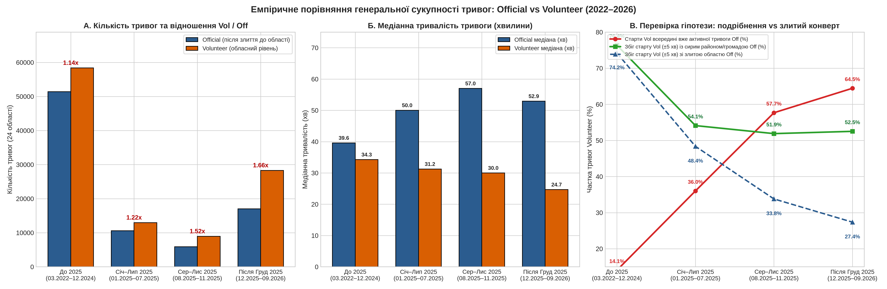
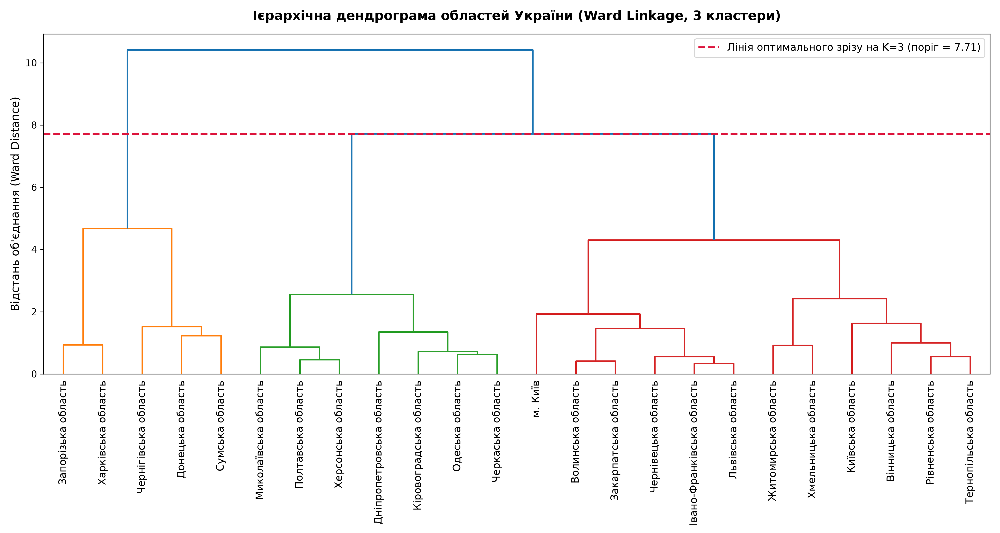
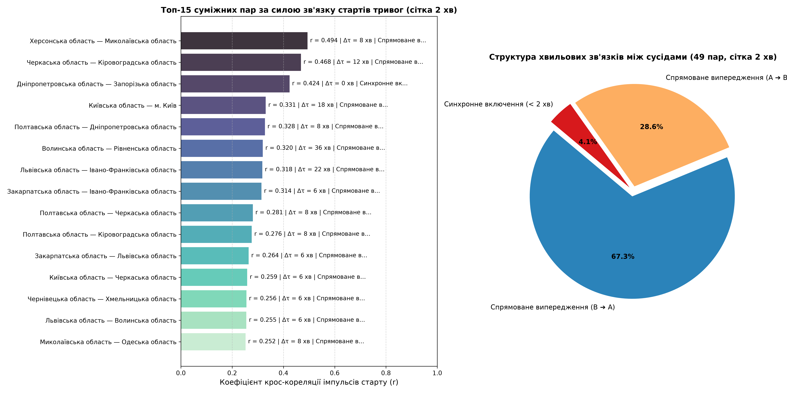
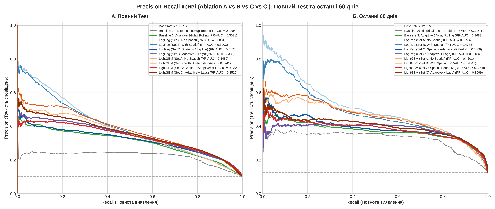
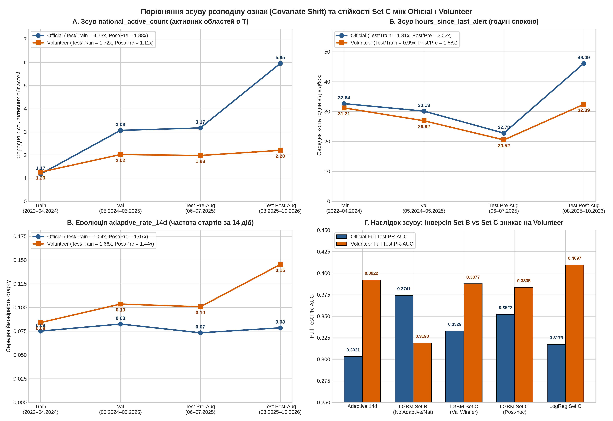
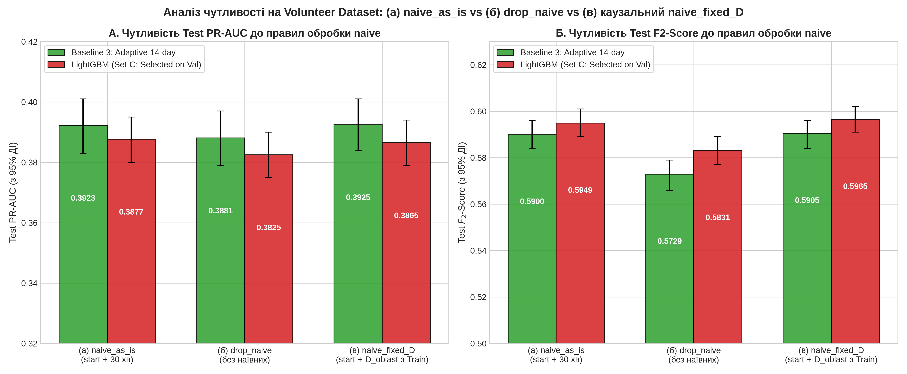
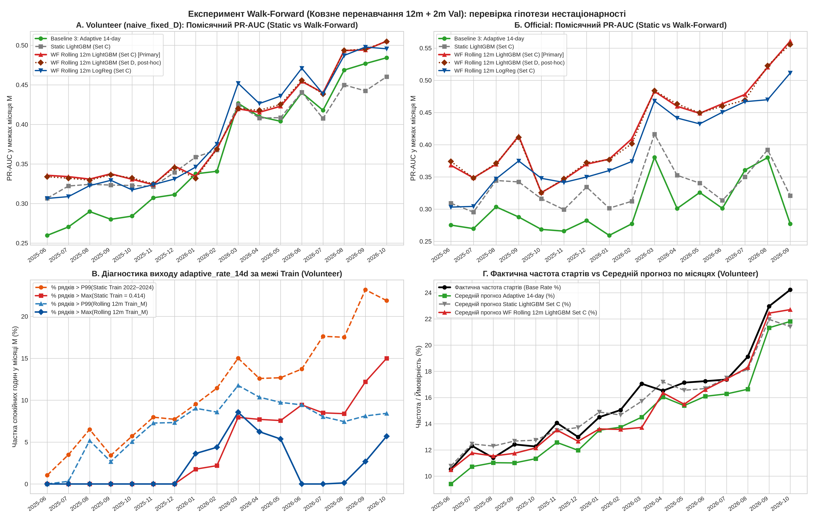
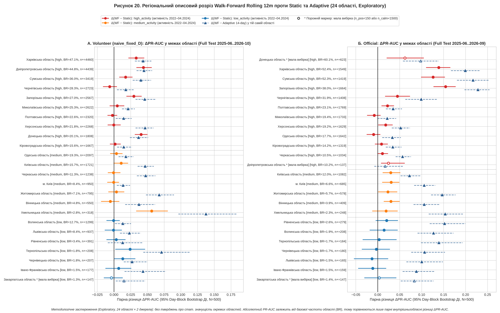

# 🚨 Просторово-часовий аналіз та короткострокове прогнозування повітряних тривог в Україні (2022–2026)

[ **🇺🇦 Українська версія** ](README.md) | [ **🇬🇧 English Version** ](README_EN.md)

[](https://www.python.org/)
[](LICENSE)
[](https://github.com/Vadimkin/ukrainian-air-raid-sirens-dataset)
[](https://parquet.apache.org/)
[](reports/comparison/official_vs_volunteer_walk_forward_comparison.csv)

Дослідницько-інженерний проєкт із вивчення просторово-часової динаміки повітряних тривог у 24 областях України (березень 2022 – жовтень 2026 рр.) та короткострокового прогнозування початку нової тривоги у спокійні години на горизонті $[T, T + 1\text{h})$. Усі гіпотези перевірено паралельно на **двох незалежних корпусах даних** — офіційному (`official_data_uk.csv`) та волонтерському (`volunteer_data_uk.csv`).

---

## ⚡ Executive Summary (Ключові висновки дослідження)

1. **Етап 1 — Стабільна просторово-часова структура між двома незалежними джерелами (RQ1–RQ3):**
   * **Циклічність (RQ1):** підтверджено статистично значущий тижневий ритм (тест Краскела-Волліса $H = 25.52, \ p = 2.74 \times 10^{-4}$ на Official; $H = 17.05, \ p = 0.0091$ на Volunteer, по 3 статистично значущі пари днів після поправки Бонферроні $\alpha_{\text{adj}} = 0.00238$) із піком у середу–п'ятницю та мінімумом у неділю, а також стабільну частку нічних стартів (`00:00–05:59 Europe/Kyiv`: **$20.2\% – 24.0\%$** за роками на Official та **$21.0\% – 26.4\%$** на Volunteer).
   * **Кластеризація областей (RQ2):** ізольована кластеризація на навчальному періоді `Train <= 2024-04-30` для ML-ознак (`low_activity`, `medium_activity`, `high_activity`: розподіл `7 / 5 / 12` на Official та `7 / 7 / 10` на Volunteer) показує високу узгодженість між джерелами, а описова кластеризація за весь період чітко виділяє 3 географічні пояси (Глибокий тил, Транзитний Центр і Північ, Прифронтова/Прикордонна зона).
   * **Просторові коридори поширення (RQ3):** крос-кореляції на 10-хвилинній сітці для 49 пар сусідніх областей демонструють високу міжджерельну узгодженість частоти сумісної активності сусідів ($\rho_{\text{Spearman}} = 0.965, \ p = 4.68 \times 10^{-29}$) та пікових крос-кореляцій ($\rho_{\text{Spearman}} = 0.411, \ p = 0.0033$) і фіксують стійкі лаги поширення у 10–20 хвилин вздовж південних, східних і центральних маршрутів.
2. **Етап 2 (Блок А) — Статичне ML-моделювання та діагностика зсуву розподілу ознак:**
   * За правилом вибору за Val PR-AUC (сформульованим після першого перегляду Test; $\arg\max \text{PR-AUC}$ на Validation `2024-05-01` – `2025-05-31`) серед базових кандидатів (`Baselines 1–3`, `LogReg A/B/C`, `LightGBM A/B/C`) обрано **`LightGBM (Set C: Spatial + Adaptive, 22 ознаки)`** (`Val PR-AUC = 0.3012` на Official; `0.3107` на Volunteer `naive_as_is` / `0.3116` на `naive_fixed_D`).
   * На повному Test (`2025-06` – `2026-09`) заморожений статичний `LightGBM (Set C)` на Official перевершує `Adaptive 14-day Baseline` ($\Delta\text{PR-AUC} = +0.0297 \ [+0.0220, +0.0373]$, $\Delta F_2 = +0.0249 \ [+0.0189, +0.0304]$), проте поступається простішому пост-хок набору `Set B` (13 ознак без історичних і національних агрегатів: `PR-AUC = 0.3741` проти `0.3329`).
   * **Зсув розподілу ознак (узгоджується з просіданням статичного `Set C`):** між `Train` (`2022–04.2024`) і `Test` (`2025-06..2026`) на Official середня кількість одночасно активних областей `national_active_count` зросла у **$4.73\times$** (`1.17` $\to$ `5.54`, а після переходу на порайонне логування `2025-08-01` — з `3.17` до `5.95`), а `neighbors_active_count` — у **$4.04\times$** (`0.13` $\to$ `0.52`), тоді як на незалежному Volunteer (де логування залишилося обласним) `national_active_count` зріс у **$1.72\times$** (`1.26` $\to$ `2.17`), `adaptive_rate_14d` — у **$1.66\times$** (`0.084` $\to$ `0.140`), а `onsets_last_24h` — у **$1.70\times$** (`1.95` $\to$ `3.32`). Таке просідання статичного `LightGBM (Set C)` **узгоджується з** гіпотезою про те, що дерева рішень, заморожені на даних 2022–2024 рр., екстраполюють із застарілими порогами розбиття (окремий інтервенційний тест для ізоляції єдиної причини не проводився).
3. **Етап 2 (Блок Б) — Чутливість до політики `naive` на Volunteer та помісячний Walk-Forward Retraining:**
   * Перевірка трьох строго каузальних політик обробки прапорця `naive` у волонтерських даних (`naive_as_is`, `drop_naive`, `naive_fixed_D` із медіаною тривалості $D_{\text{oblast}}$ строго з `Train`; див. Розділ 3.3) показала однаковий напрямок і статистичну значущість ключових порівнянь у всіх трьох варіантах: статичний `LightGBM (Set C)` переважає `Adaptive 14-day` за $F_2$-Score ($\Delta F_2 = +0.0050 \ [+0.0025, +0.0079]$, $+0.0092 \ [+0.0066, +0.0119]$ та $+0.0055 \ [+0.0030, +0.0082]$ відповідно), тоді як різниця за $\text{PR-AUC}$ у кожній політиці статистично незначуща і перетинає нуль ($\Delta\text{PR-AUC} = -0.0042 \ [-0.0087, +0.0002]$, $-0.0034 \ [-0.0083, +0.0014]$ та $-0.0019 \ [-0.0065, +0.0024]$).
   * Перехід до **помісячного донавчання (`LightGBM Set C [WF Rolling 12m]`, 12m Train + 2m Val з 2-годинним буфером `embargo`)** дає різний за величиною приріст якості бустингу залежно від джерела даних — великий на Official ($\Delta\text{PR-AUC}_{\text{WF − Static}} = +0.0873 \ [+0.0789, +0.0950]$ на повному Test та $+0.1324 \ [+0.1092, +0.1565]$ на останніх 60 днях) і помірний, але статистично значущий на Volunteer ($\Delta\text{PR-AUC}_{\text{WF − Static}} = +0.0147 \ [+0.0110, +0.0180]$ на повному Test та $+0.0430 \ [+0.0331, +0.0520]$ на останніх 60 днях):
     * **Official:** Pooled `PR-AUC` зростає з `0.3329` (Static) до **`0.4203 [0.409, 0.431]`** ($\Delta_{\text{vs Adapt}} = +0.1171 \ [+0.1081, +0.1261]$, $\Delta_{\text{WF − Static}} = +0.0873 \ [+0.0789, +0.0950]$, виграш у `16/16` місяців), а на останніх 60 днях — з `0.3809` до **`0.5139 [0.488, 0.541]`** ($\Delta_{\text{vs Adapt}} = +0.1450 \ [+0.1177, +0.1726]$).
     * **Volunteer (`naive_fixed_D`):** `LightGBM (Set C) [WF Rolling 12m]` статистично значуще перемагає `Adaptive 14-day` як на повному Test (`0.4050 [0.397, 0.413]` проти `0.3924`, $\Delta_{\text{vs Adapt}} = +0.0128 \ [+0.0082, +0.0168]$, $\Delta_{\text{WF − Static}} = +0.0147 \ [+0.0110, +0.0180]$, виграш у `15/17` місяців), так і на останніх 60 днях (`0.4975 [0.486, 0.512]` проти `0.4810`, $\Delta_{\text{vs Adapt}} = +0.0167 \ [+0.0089, +0.0252]$, $\Delta_{\text{WF − Static}} = +0.0430 \ [+0.0331, +0.0520]$).
     * **⚠️ Важливе застереження для Volunteer:** на волонтерському датасеті `LightGBM (Set C) [WF Rolling 12m]` **не є безумовно найкращою моделлю за всіма метриками** — за `PR-AUC` він трохи поступається статичній лінійній моделі `LogReg (Set C) [Static Initial Train]` (`0.4050` проти `0.4097` на повному Test, $\Delta = -0.0046 \ [-0.0081, -0.0013]$; `0.4975` проти `0.5002` на останніх 60 днях, $\Delta = -0.0027 \ [-0.0073, +0.0028]$), переважаючи її лише за пороговою метрикою $F_2$-Score ($\Delta F_2 = +0.0064 \ [+0.0044, +0.0083]$) та калібруванням імовірностей (`Brier = 0.1093` проти `0.2645`).

---

## 📑 Зміст
1. [Дані, верифікація джерел та каузальне очищення](#-1-дані-верифікація-джерел-та-каузальне-очищення)
2. [Етап 1: Описова аналітика просторово-часових закономірностей (RQ1–RQ3)](#-2-етап-1-описова-аналітика-просторово-часових-закономірностей-rq1rq3)
3. [Етап 2 (Блок А): Статичне ML-моделювання, зсув ознак та чутливість до `naive`](#-3-етап-2-блок-а-статичне-ml-моделювання-зсув-ознак-та-чутливість-до-naive)
4. [Етап 2 (Блок Б): Помісячне донавчання (Monthly Walk-Forward Retraining)](#-4-етап-2-блок-б-помісячне-донавчання-monthly-walk-forward-retraining)
5. [Регіональний розріз Walk-Forward по 24 областях (Exploratory)](#-5-регіональний-розріз-walk-forward-по-24-областях-exploratory)
6. [Каузальна інваріантність, методичні обмеження та Future Work](#-6-каузальна-інваріантність-методичні-обмеження-та-future-work)
7. [Швидкий старт (Quickstart)](#-7-швидкий-старт-quickstart)
8. [Структура репозиторію](#-8-структура-репозиторію)

---

## 📦 1. Дані, верифікація джерел та каузальне очищення

Обидва сирі набори даних походять з відкритого репозиторію [Vadimkin/ukrainian-air-raid-sirens-dataset](https://github.com/Vadimkin/ukrainian-air-raid-sirens-dataset) (дата верифікації: `2026-10-11`, [`reports/comparison/upstream_source_verification.json`](reports/comparison/upstream_source_verification.json)) і проходять перевірку контрольних сум `SHA-256`, дедуплікацію та реконструкцію неперервних обласних інтервалів `[started_at, finished_at]` у модулі [`src/data/cleaner.py`](src/data/cleaner.py).

### Таблиця 1.1. Порівняльний паспорт двох джерел даних та водоспаду очищення

| Параметр / Етап обробки | Джерело 1: Official (`official_data_uk.csv`) | Джерело 2: Volunteer (`volunteer_data_uk.csv`) |
| :--- | :--- | :--- |
| **Файл сирих даних та SHA-256** | [`data/raw/official_data_uk.csv`](data/raw/official_data_uk.csv)<br>`1f50085481d229f57b624d83b1ce723e884dea409c14afb5b7040c8a2f233e4f` | [`data/raw/volunteer_data_uk.csv`](data/raw/volunteer_data_uk.csv)<br>`1ead8618b1f5eb8eda2fe4a14e5fefa773a14534aba21aae577e463189da783b` |
| **Часове охоплення (UTC)** | `2022-03-15 16:10:34` – `2026-09-07 05:28:22` | Сирі: `2022-02-25 16:36:22` – `2026-10-11 04:36:59`<br>З `2022-03-15`: `2022-03-15 00:05:01` – `2026-10-11 04:36:59` |
| **Кількість сирих рядків** | `299 275` рядків (містить дубльований блок в upstream) | `115 989` рядків (`5 812` або `5.01%` із прапорцем `naive == True`) |
| **Крок 1: Дедуплікація та вирівнювання старту** | `-113 845` точних дублікатів $\to$ **`185 430`** унікальних записів | `0` дублікатів; вилучено `-1 099` записів до `2022-03-15 00:00 UTC` $\to$ **`114 890`** записів у [`cleaner.py`](src/data/cleaner.py) (`clean_volunteer_data()`) |
| **Крок 2: Фільтр мікро-збоїв ($< 60\text{ с}$)** | `-453` записи (`duration < 60s` або $<0$) $\to$ **`184 977`** записів | `-1 365` записів (`duration < 60s`) $\to$ **`113 525`** записів (`5 659` із `naive == True`) |
| **Крок 3: Політика рівнів / `naive`** | До `2025-08-01`: лише `level == 'oblast'` (`-14 767` локальних записів) $\to$ **`170 210`** записів; з `2025-08-01`: об'єднання `oblast/raion/hromada` | 3 каузальні варіанти для `naive == True`:<br>• `naive_as_is` (+30 хв)<br>• `drop_naive` (вилучення `-5 659` рядків)<br>• `naive_fixed_D` (медіана $D_{\text{oblast}}$ строго з `Train <= 2024-04-30`) |
| **Крок 4: Злиття перетинних інтервалів** | Консолідовано `-85 302` вкладених записів $\to$ **`84 908`** інтервалів (`84 907` у 24 областях + `1` у Луганській) | • `naive_as_is`: **`113 525`** інтервалів (`113 523` у 24 областях + `2` ТОТ)<br>• `drop_naive`: **`107 866`** інтервалів (`107 866` у 24 областях)<br>• `naive_fixed_D`: **`113 525`** інтервалів (`113 523` у 24 областях + `2` ТОТ) |
| **Крок 5: Погодинний Feature Store (`is_active_T == 0`)** | [`data/processed/ml_features_hourly.parquet`](data/processed/ml_features_hourly.parquet):<br>**`797 428`** спокійних людино-годин (`0` дублікатів) | • `as_is`: **`871 505`** спокійних годин<br>• `drop_naive`: **`874 375`** спокійних годин<br>• `fixed_D`: **`870 938`** спокійних годин |

Загальна календарна сітка тестового вікна Official (`2025-06-01 00:00` – `2026-09-07 04:00 UTC`, `11 117` год $\times$ `24` області) налічує `266 808` регіоно-годин, з яких після виключення `69 725` годин активної тривоги (`is_active_T == 1`) у тестовій вибірці залишається рівно **`197 083` спокійні регіоно-години** (`266 808 − 69 725 = 197 083`).

<details>
<summary><b>🔍 Детальний аудит 3 блоків дублікатів в upstream-репозиторії Vadimkin (Official CSV) та історії першої ітерації</b></summary>

Пряме завантаження й перевірка файлу з `https://raw.githubusercontent.com/Vadimkin/ukrainian-air-raid-sirens-dataset/main/datasets/official_data_uk.csv` ([`src/data/verify_upstream_source.py`](src/data/verify_upstream_source.py), звіт [`reports/comparison/upstream_source_verification.json`](reports/comparison/upstream_source_verification.json)) підтвердили, що файл у репозиторії `Vadimkin` містить `299 275` рядків (SHA-256 ідентичний локальному файлу), а дублювання присутнє безпосередньо в upstream:
* **Блок 1 (рядки `0..113 910`, `113 911` рядків):** охоплює період `2022-03-15 16:10:34 UTC` – `2026-01-25 13:11:52 UTC` (`0` внутрішніх дублікатів).
* **Блок 2 (рядки `113 911..227 831`, `113 921` рядок):** повторно охоплює той самий часовий діапазон `2022-03-15 16:10:34 UTC` – `2026-01-25 13:11:52 UTC` і містить `113 845` точних дублікатів рядків Блоку 1 за всіма 6 колонками (`oblast, raion, hromada, level, started_at, finished_at`) та `76` рядків, що не збігаються з Блоком 1 (`0` внутрішніх дублікатів усередині Блоку 2).
* **Блок 3 (рядки `227 832..299 274`, `71 443` рядки):** записи за `2026-01-23 12:42:58 UTC` – `2026-09-07 05:28:22 UTC` (`0` внутрішніх дублікатів та `0` перетинів із Блоками 1–2).
* **Чому змінилися цифри після виправлення `cleaner.py`:** до дедуплікації блоку `0..227 831` та агрегації порайонних тривог після серпня 2025 р. абсолютні частоти в RQ1–RQ2 були штучно подвоєні, а базова частота на Test занижена через перехід логування з рівня `oblast` на `raion`. Після видалення `113 845` дублікатів та реконструкції обласних інтервалів із `raion`/`hromada` всі метрики відображають реальний процес (базова частота стартів на Test — **$10.27\%$**, за останні 60 днів — **$12.65\%$**).
</details>

---

## 🔬 2. Етап 1: Описова аналітика просторово-часових закономірностей (RQ1–RQ3)

Усі три дослідницькі питання першого етапу перевірені паралельно на Official (`84 907` інтервалів по 24 областях) та Volunteer (`113 523` інтервали по 24 областях у `naive_as_is`; `108 576` на спільному часовому вікні до `2026-09-07`).

### 2.1. Часова циклічність та тривалість тривог (RQ1)
* **Тижневий ритм (тест Краскела-Волліса, [`src/features/cyclicity.py`](src/features/cyclicity.py)):**
  * **Official:** $H = 25.52, \ p = 2.74 \times 10^{-4}$ (3 статистично значущі пари днів після поправки Бонферроні $\alpha_{\text{adj}} = 0.00238$). Пік — середа–п'ятниця (медіана 52–53 об'єднаних обласних тривог на добу, середнє 53.4–55.0), мінімум — неділя (медіана 47, середнє 46.8 тривог/добу).
  * **Volunteer (`naive_as_is`):** $H = 17.05, \ p = 0.0091$ (також 3 статистично значущі пари днів після поправки Бонферроні), аналогічне зростання активності у середині робочого тижня та спад у неділю.
* **Добовий профіль та нічні тривоги (`00:00–05:59 Europe/Kyiv`):** після коректної агрегації порайонних тривог у 2025–2026 роках частка тривог, що починаються вночі, залишається стабільною в діапазоні **$20.2\% – 24.0\%$** за роками на Official (2022: $24.0\%$, 2023: $21.5\%$, 2024: $20.2\%$, 2025: $20.5\%$, 2026: $22.9\%$) та **$21.0\% – 26.4\%$** на Volunteer (2022: $23.8\%$, 2023: $21.0\%$, 2024: $21.4\%$, 2025: $26.4\%$, 2026: $22.5\%$).
* **Порівняння тривалостей між джерелами ([`reports/comparison/official_vs_volunteer_comparison.csv`](reports/comparison/official_vs_volunteer_comparison.csv)):** на спільному вікні `2022-03-15 .. 2026-09-07` медіанна тривалість на Official становить **43.15 хв** (середнє **102.40 хв**), тоді як на Volunteer — **30.68 хв** (середнє **49.06 хв**), оскільки після серпня 2025 р. об'єднання всіх районів області на Official утворює довші неперервні обласні інтервали, всередині яких на Volunteer фіксується кілька коротших хвиль ($64.5\%$ стартів Volunteer після грудня 2025 р. припадають всередину вже відкритого інтервалу Official).

<p align="center">
  
  <br><em>Рис 1. Теплокарта кількості оголошених тривог за годинами доби (Europe/Kyiv) та днями тижня (Official, 2022–2026).</em>
</p>

<p align="center">
  
  <br><em>Рис 2. Міжджерельне порівняння кількості та тривалості тривог між Official та Volunteer за історичними підперіодами (Рис. 17 у reports/comparison/figures/).</em>
</p>

### 2.2. Регіональна кластеризація: Описова (RQ2) vs ML (Train-Only)
У проєкті суворо розмежовано **описову кластеризацію за весь період** (для відповіді на RQ2) та **ізольовану кластеризацію строго на `Train <= 2024-04-30`** (яка подається як ознака в ML-моделі без жодного витоку з майбутнього):

1. **Описова кластеризація RQ2 ([`reports/official/regional_clusters_summary.csv`](reports/official/regional_clusters_summary.csv), весь період 2022–2026, Ward linkage, Silhouette = 0.4417 при $K=3$):**
   * **Кластер 1 — Глибокий тил / Захід (12 областей на Official / 10 на Volunteer):** Івано-Франківська, Волинська, Вінницька, Житомирська, Закарпатська, Київська, Львівська, Рівненська, Тернопільська, Хмельницька, Чернівецька, м. Київ (сер. 25.8 тр/міс, медіана тривалості 46.4 хв на Official).
   * **Кластер 2 — Транзитний центр / Північ (7 областей на Official / 8 на Volunteer):** Дніпропетровська, Кіровоградська, Миколаївська, Одеська, Полтавська, Херсонська, Черкаська (сер. 90.3 тр/міс, медіана тривалості 36.0 хв на Official).
   * **Кластер 3 — Прифронтова / Прикордонна зона (5 областей на Official / 6 на Volunteer):** Донецька, Запорізька, Сумська, Харківська, Чернігівська (сер. 128.3 тр/міс, медіана тривалості 57.3 хв, частка тривог $\ge 2$ год — 28.7% на Official).
2. **ML-кластери строго на `Train` ([`reports/official/clusters_train_only.csv`](reports/official/clusters_train_only.csv), період до `2024-04-30 23:59:59 UTC`, функція `generate_train_only_clusters()` у [`src/features/clustering.py`](src/features/clustering.py)):**
   * `cluster_1_low_activity` (`low_activity (активність 2022–04.2024)`, 7 західних областей): Івано-Франківська, Волинська, Закарпатська, Львівська, Рівненська, Тернопільська, Чернівецька (17.4–22.1 тр/міс).
   * `cluster_2_medium_activity` (`medium_activity (активність 2022–04.2024)`, 5 центрально-північних областей на Official): Вінницька, Житомирська, Київська, Хмельницька, м. Київ (24.2–38.2 тр/міс). *(Примітка: на Volunteer у [`volunteer_clusters_train_only.csv`](reports/volunteer/volunteer_clusters_train_only.csv) та [`volunteer_clusters_train_only_fixed_d.csv`](reports/volunteer/volunteer_clusters_train_only_fixed_d.csv) до `medium_activity` на Train також входять Одеська та Черкаська області, формуючи розподіл `7 low / 7 medium / 10 high`).*
   * `cluster_3_high_activity` (`high_activity (активність 2022–04.2024)`, 12 областей Півдня, Сходу та Центру на Official / 10 на Volunteer): Дніпропетровська, Донецька, Запорізька, Кіровоградська, Миколаївська, Одеська, Полтавська, Сумська, Харківська, Херсонська, Черкаська, Чернігівська (44.0–168.8 тр/міс).

<p align="center">
  
  <br><em>Рис 3. Дендрограма ієрархічної кластеризації 24 областей України (RQ2, Ward linkage, Official).</em>
</p>

### 2.3. Просторово-часові кореляції між сусідами (RQ3)
* Після фільтрації синхронних загальнонаціональних тривог ($\ge 15$ областей одночасно) на 10-хвилинній сітці для 49 пар суміжних областей розраховано крос-кореляції з лагами $\tau \in [-180, +180]$ хв ([`reports/official/spatial_lead_lag_summary.csv`](reports/official/spatial_lead_lag_summary.csv), [`reports/volunteer/spatial_lead_lag_summary.csv`](reports/volunteer/spatial_lead_lag_summary.csv)).
* Рангова кореляція Спірмена між кількістю спільних активних 10-хвилинних інтервалів (`joint_active_intervals`) для 49 пар сусідів на Official і Volunteer становить **$\rho = 0.965$** ($p = 4.68 \times 10^{-29}$), а між піковими крос-кореляціями (`max_correlation`) — **$\rho = 0.411$** ($p = 0.0033$). На Official найсильніший зв'язок фіксується вздовж південних, східних та центральних коридорів: Миколаївська $\to$ Херсонська ($r = 0.658$, лаг 10 хв), Дніпропетровська $\leftrightarrow$ Запорізька ($r = 0.613$, лаг 0 хв), Івано-Франківська $\to$ Львівська ($r = 0.602$, лаг 10 хв), м. Київ $\to$ Київська ($r = 0.578$, лаг 10 хв), Чернігівська $\to$ Сумська ($r = 0.574$, лаг 10 хв).

<p align="center">
  
  <br><em>Рис 4. Топ-15 суміжних пар областей за силою крос-кореляції та структура часових затримок (Official).</em>
</p>

---

## 🤖 3. Етап 2 (Блок А): Статичне ML-моделювання, зсув ознак та чутливість до `naive`

### 3.1. Постановка задачі, ієрархія наборів ознак та правило вибору за Val PR-AUC (сформульоване після першого перегляду Test)
* **Одиниця прогнозу $(T, \text{oblast})$:** регулярна годинна сітка в UTC (`timestamp_utc`), кондиціонована на стан спокою (`is_active_T == 0`).
* **Цільова змінна (`target_onset_next_1h`):** $y_T = 1$, якщо нова тривога в області починається у піввідкритому інтервалі **$[T, T + 1\text{h})$**.
* **Ієрархія наборів ознак (усі обчислюються строго з даних до моменту $T$, `closed="left"`, на повній годинній сітці до фільтрації спокою):**
  * **Набір A (Time, Burden & Train Cluster — 10 ознак):** `hour_sin`, `hour_cos`, `day_of_week`, `is_weekend`, `month` (за `Europe/Kyiv`), `burden_last_6h`, `burden_last_24h` (частка активних годин у $[T-6\text{h}, T)$ та $[T-24\text{h}, T)$), та One-Hot індикатори кластера з Train (`cluster_1_low_activity`, `cluster_2_medium_activity`, `cluster_3_high_activity`).
  * **Набір B (A + Spatial at $T$ — 13 ознак):** Набір A + миттєвий стан сусідніх областей рівно в момент $T$: `neighbors_active_count`, `neighbor_any_active`, `neighbor_active_ratio`.
  * **Набір C (B + Adaptive & Spatio-Temporal Memory — 22 ознаки, основна конфігурація за правилом вибору за Val PR-AUC, сформульованим після першого перегляду Test):** Набір B + 9 адаптивних та просторово-часових ознак: `adaptive_rate_7d/14d/30d`, `national_active_count`, `onsets_last_24h`, `hours_since_last_alert` (`clip(upper=720.0)`), `neighbors_active_lag_1h/2h/3h`.
  * **Набір C' (`FEATURE_SET_C_PRIME`: B + Adaptive & Neighbor Lags Only — 19 ознак, пост-хок експеримент):** Набір C без трьох найбільш чутливих до зсуву розподілу ознак (`national_active_count`, `hours_since_last_alert`, `onsets_last_24h`).
  * **Набір D (`FEATURE_SET_D_POST_HOC`: Set C + 3 відносні ознаки `+Rel Ratios` — 25 ознак, пост-хок exploratory у блоці Walk-Forward):** Набір C + 3 поточкові каузальні відношення активності у [`src/models/run_walk_forward_experiment.py`](src/models/run_walk_forward_experiment.py): `rel_activity_24h_vs_14d`, `adaptive_ratio_7d_vs_30d`, `adaptive_diff_14d_minus_30d`.
* **Правило вибору за Val PR-AUC (сформульоване після першого перегляду Test, [`reports/official/val_evaluation_details.json`](reports/official/val_evaluation_details.json)):**
  * Правило вибору за Val PR-AUC (сформульоване після першого перегляду Test): $\arg\max \text{PR-AUC}$ на вибірці Validation (`2024-05-01` – `2025-05-31`) серед базових кандидатів (`Baselines 1–3`, `LogReg A/B/C`, `LightGBM A/B/C`).
  * Обрана модель на Validation: **`LightGBM (Set C: Spatial + Adaptive)`** як на Official (`Val PR-AUC = 0.3012 [0.292, 0.311]`, `Val F2 = 0.5331 [0.526, 0.540]`), так і на Volunteer (`Val PR-AUC = 0.3107 [0.303, 0.318]`, `Val F2 = 0.5321 [0.525, 0.539]` у `naive_as_is` та `Val PR-AUC = 0.3116`, `Val F2 = 0.5327` у `naive_fixed_D`).
  * Усі висновки про перевагу статичного `Set B` за PR-AUC та конструювання `Set C'` і `Set D` зроблені **після перегляду результатів на Test і є пост-хок (`post-hoc`)**.

### Таблиця 3.1. Статичний бенчмарк на повній тестовій вибірці Official (`2025-06-01` – `2026-09-07`, `197 083` рядки, [`reports/official/ml_models_benchmark.csv`](reports/official/ml_models_benchmark.csv))
*95% довірчі інтервали розраховано методом **Day-Block Bootstrap за календарними добами** (`n_bootstraps = 500`). Колонка `Prec @ R=78.2%` показує точність при фіксованій повноті адаптивного бейзлайну (`Recall = 78.23%`).*

| Модель | Набір ознак | Статус у протоколі | Поріг $p^*$ (з Val) | Test PR-AUC [95% CI] | Test $F_2$ [95% CI] | Precision | Recall | Prec @ R=78.2% | Brier Score |
| :--- | :--- | :--- | :---: | :---: | :---: | :---: | :---: | :---: | :---: |
| **Baseline 1: True Naive** | Лаг старту в $[T-1\text{h}, T)$ | `кандидат за правилом вибору за Val PR-AUC (сформульованим після першого перегляду Test)` | 0.500 | — | 0.1034 [0.096, 0.111] | 29.1% | 8.9% | — | 0.1159 |
| **Baseline 2: Historical Lookup** | Таблиця шансів Train (Kyiv) | `кандидат за правилом вибору за Val PR-AUC (сформульованим після першого перегляду Test)` | 0.085 | 0.2204 [0.212, 0.228] | 0.5033 [0.495, 0.511] | 22.7% | 72.3% | 21.1% | 0.0868 |
| **Baseline 3: Adaptive 14-day** | Ковзна частота за 14 діб | `кандидат за правилом вибору за Val PR-AUC (сформульованим після першого перегляду Test)` | 0.089 | 0.3031 [0.292, 0.315] | 0.5299 [0.520, 0.538] | 23.1% | 78.2% | 23.1% | 0.0818 |
| **LogReg (Set A: No Spatial)** | A (10 ознак) | `кандидат за правилом вибору за Val PR-AUC (сформульованим після першого перегляду Test)` | 0.518 | 0.3881 [0.377, 0.399] | 0.5329 [0.524, 0.541] | 23.5% | 77.9% | 23.4% | 0.2007 |
| **LogReg (Set B: With Spatial)** | B (13 ознак) | `кандидат за правилом вибору за Val PR-AUC (сформульованим після першого перегляду Test)` | 0.561 | **0.3903** [0.380, 0.400] | 0.5499 [0.541, 0.558] | 24.0% | 81.2% | 25.1% | 0.2337 |
| **LogReg (Set C: Spatial + Adaptive)** | C (22 ознаки) | `кандидат за правилом вибору за Val PR-AUC (сформульованим після першого перегляду Test)` | 0.565 | 0.3173 [0.306, 0.328] | 0.5431 [0.535, 0.550] | 21.1% | **89.3%** | 25.3% | 0.2875 |
| **LogReg (Set C': Adaptive + Lags)** | C' (19 ознак) | `post-hoc sensitivity` | 0.541 | 0.3386 [0.327, 0.350] | 0.5527 [0.544, 0.561] | 24.1% | 81.6% | 25.6% | 0.2265 |
| **LightGBM (Set A: No Spatial)** | A (10 ознак) | `кандидат за правилом вибору за Val PR-AUC (сформульованим після першого перегляду Test)` | 0.093 | 0.3482 [0.337, 0.359] | 0.5379 [0.529, 0.546] | 25.4% | 74.6% | 23.5% | 0.0784 |
| **LightGBM (Set B: With Spatial)** | B (13 ознак) | `кандидат за правилом вибору за Val PR-AUC (сформульованим після першого перегляду Test)` *(post-hoc best PR-AUC)* | 0.109 | 0.3741 [0.363, 0.386] | 0.5610 [0.552, 0.570] | 23.5% | 85.8% | 26.8% | **0.0761** |
| **LightGBM (Set C: Spatial + Adaptive)** | C (22 ознаки) | **`обрано за правилом вибору за Val PR-AUC (сформульованим після першого перегляду Test)`** | 0.129 | 0.3329 [0.323, 0.343] | 0.5551 [0.547, 0.562] | 23.0% | 85.8% | 26.3% | 0.0783 |
| **LightGBM (Set C': Adaptive + Lags)** | C' (19 ознак) | `post-hoc sensitivity` | 0.129 | 0.3522 [0.342, 0.363] | **0.5683** [0.559, 0.577] | **25.7%** | 81.6% | **27.1%** | 0.0767 |

### Таблиця 3.2. Статичний бенчмарк на останніх 60 днях Official (`2026-07-09` – `2026-09-07`, `23 646` рядків, базова частка `12.65%`, [`reports/official/ml_recent_60d_benchmark.csv`](reports/official/ml_recent_60d_benchmark.csv))

| Модель | Набір ознак | Поріг $p^*$ | PR-AUC [95% CI] | $F_2$-Score [95% CI] | Precision | Recall | Prec @ R=90.4% | Brier Score |
| :--- | :--- | :---: | :---: | :---: | :---: | :---: | :---: | :---: |
| **Baseline 1: True Naive** | Лаг $[T-1\text{h}, T)$ | 0.500 | — | 0.1621 [0.145, 0.181] | 39.2% | 14.1% | — | 0.1364 |
| **Baseline 2: Historical Lookup** | Таблиця Train (Kyiv) | 0.085 | 0.3257 [0.295, 0.357] | 0.5886 [0.564, 0.613] | 33.1% | 73.0% | 31.7% | 0.1038 |
| **Baseline 3: Adaptive 14-day** | Ковзна за 14 діб | 0.089 | 0.3682 [0.333, 0.406] | 0.6430 [0.620, 0.664] | 29.9% | 90.4% | 34.1% | 0.0911 |
| **LogReg (Set A: No Spatial)** | A (10 ознак) | 0.518 | **0.5058** [0.480, 0.531] | 0.6535 [0.636, 0.674] | 35.5% | 82.8% | **38.5%** | 0.1693 |
| **LogReg (Set B: With Spatial)** | B (13 ознак) | 0.561 | 0.4788 [0.444, 0.510] | 0.6501 [0.626, 0.674] | 32.7% | 86.3% | 37.6% | 0.2064 |
| **LogReg (Set C: Spatial + Adaptive)** | C (22 ознаки) | 0.565 | 0.3889 [0.354, 0.423] | 0.6196 [0.592, 0.643] | 25.8% | **95.5%** | 35.7% | 0.2974 |
| **LogReg (Set C': Adaptive + Lags)** *(post-hoc)* | C' (19 ознак) | 0.541 | 0.3803 [0.343, 0.417] | 0.6494 [0.622, 0.675] | 30.9% | 89.6% | 36.6% | 0.2304 |
| **LightGBM (Set A: No Spatial)** | A (10 ознак) | 0.093 | 0.4501 [0.423, 0.477] | **0.6559** [0.639, 0.674] | **37.0%** | 81.3% | 38.4% | 0.0885 |
| **LightGBM (Set B: With Spatial)** *(post-hoc)* | B (13 ознак) | 0.109 | 0.4541 [0.424, 0.481] | 0.6442 [0.617, 0.670] | 29.9% | 90.5% | 37.1% | **0.0853** |
| **LightGBM (Set C: Spatial + Adaptive)** *(обрано за правилом вибору за Val PR-AUC)* | C (22 ознаки) | 0.129 | 0.3809 [0.348, 0.416] | 0.6301 [0.603, 0.654] | 27.3% | 93.5% | 34.4% | 0.0895 |
| **LightGBM (Set C': Adaptive + Lags)** *(post-hoc)* | C' (19 ознак) | 0.129 | 0.3999 [0.367, 0.437] | 0.6527 [0.628, 0.677] | 31.2% | 89.9% | 36.0% | 0.0868 |

<p align="center">
  
  <br><em>Рис 5. Криві Precision-Recall для статичних моделей наборів A, B, C, C' та бейзлайнів на повному Test (ліворуч) і за останні 60 днів (праворуч) на Official.</em>
</p>

### 3.2. Аналіз зсуву розподілу ознак (Covariate Shift) на Official і Volunteer
Скрипт [`src/features/analyze_feature_shift.py`](src/features/analyze_feature_shift.py) порівнює середні значення ознак між `Train`, `Val` та `Test` на обох джерелах ([`reports/comparison/official_vs_volunteer_feature_shift_comparison.csv`](reports/comparison/official_vs_volunteer_feature_shift_comparison.csv)):

| Ознака | Official: Train $\to$ Val $\to$ Test | Official: До / Після `01.08.2025` | Official: Test / Train | Volunteer (`as_is`): Train $\to$ Val $\to$ Test | Volunteer: До / Після `01.08.2025` | Volunteer: Test / Train |
| :--- | :---: | :---: | :---: | :---: | :---: | :---: |
| **`national_active_count`** | `1.17` $\to$ `3.06` $\to$ **`5.54`** | `3.17` $\to$ `5.95` ($1.88\times$) | **$4.73\times$** | `1.26` $\to$ `2.02` $\to$ **`2.17`** | `1.98` $\to$ `2.20` ($1.11\times$) | **$1.72\times$** |
| **`neighbors_active_count`** | `0.13` $\to$ `0.32` $\to$ **`0.52`** | `0.34` $\to$ `0.55` ($1.62\times$) | **$4.04\times$** | `0.16` $\to$ `0.28` $\to$ **`0.32`** | `0.27` $\to$ `0.32` ($1.21\times$) | **$1.97\times$** |
| **`hours_since_last_alert`** | `32.6` $\to$ `30.1` $\to$ **`42.7`** | `22.8` $\to$ `46.1` ($2.02\times$) | **$1.31\times$** | `31.2` $\to$ `26.9` $\to$ **`30.9`** | `20.5` $\to$ `32.4` ($1.58\times$) | **$0.99\times$** |
| **`adaptive_rate_14d`** | `0.075` $\to$ `0.083` $\to$ **`0.078`** | `0.073` $\to$ `0.079` ($1.07\times$) | **$1.04\times$** | `0.084` $\to$ `0.104` $\to$ **`0.140`** | `0.101` $\to$ `0.145` ($1.44\times$) | **$1.66\times$** |
| **`onsets_last_24h`** | `1.73` $\to$ `1.89` $\to$ **`1.80`** | `1.75` $\to$ `1.81` ($1.03\times$) | **$1.04\times$** | `1.95` $\to$ `2.41` $\to$ **`3.32`** | `2.43` $\to$ `3.44` ($1.42\times$) | **$1.70\times$** |
| **`target_onset_next_1h`** | `0.081` $\to$ `0.102` $\to$ **`0.103`** | `0.096` $\to$ `0.104` ($1.08\times$) | **$1.27\times$** | `0.091` $\to$ `0.115` $\to$ **`0.153`** | `0.114` $\to$ `0.159` ($1.39\times$) | **$1.69\times$** |

<p align="center">
  
  <br><em>Рис 6. Порівняння кратності зсуву середніх значень ознак (Test / Train) між Official та Volunteer (Рис. 16 у reports/comparison/figures/).</em>
</p>

### 3.3. Незалежна перевірка на Volunteer та чутливість до 3 каузальних політик `naive`
У волонтерському корпусі (`data/raw/volunteer_data_uk.csv`) частина історичних записів має прапорець `naive == True` (де час завершення тривоги був невідомий і замінений на `started_at + 30 хв`). Щоб переконатися у відсутності артефактів імпутації, у [`src/models/run_volunteer_experiment.py`](src/models/run_volunteer_experiment.py) оцінено **три строго каузальні політики** ([`reports/volunteer/volunteer_naive_sensitivity.csv`](reports/volunteer/volunteer_naive_sensitivity.csv)):

| Політика обробки `naive` | Спокійних годин (всього / Test) | Базова частка Test (`positives`) | Adaptive 14d: Test PR-AUC [95% CI] / Test $F_2$ [95% CI] | LightGBM (Set C, static): Test PR-AUC [95% CI] / Test $F_2$ [95% CI] | Парна різниця $\Delta\text{PR-AUC}$ (`LGBM C − Adaptive`) | Парна різниця $\Delta F_2$ (`LGBM C − Adaptive`) |
| :--- | :---: | :---: | :---: | :---: | :---: | :---: |
| **`(а) naive_as_is`** (`started_at + 30 хв`) | `871,505` / `256,807` | `15.31%` (`39,328`) | `0.3922 [0.383, 0.401]`<br>`0.5900 [0.584, 0.596]` | `0.3877 [0.381, 0.395]`<br>`0.5951 [0.589, 0.601]` | $-0.0042 \ [-0.0087, +0.0002]$ | **`+0.0050 [+0.0025, +0.0079]`** |
| **`(б) drop_naive`** (вилучення `naive == True`) | `874,375` / `258,051` | `14.41%` (`37,189`) | `0.3881 [0.379, 0.397]`<br>`0.5728 [0.565, 0.579]` | `0.3843 [0.377, 0.392]`<br>`0.5821 [0.576, 0.588]` | $-0.0034 \ [-0.0083, +0.0014]$ | **`+0.0092 [+0.0066, +0.0119]`** |
| **`(в) naive_fixed_D`** (медіана $D_{\text{oblast}}$ строго з `Train`) | `870,938` / `256,490` | `15.33%` (`39,328`) | `0.3924 [0.384, 0.401]`<br>`0.5905 [0.584, 0.596]` | `0.3902 [0.383, 0.397]`<br>`0.5960 [0.590, 0.602]` | $-0.0019 \ [-0.0065, +0.0024]$ | **`+0.0055 [+0.0030, +0.0082]`** |

<p align="center">
  
  <br><em>Рис 7. Чутливість PR-AUC та F2-Score на тестовій вибірці Volunteer до трьох каузальних політик обробки прапорця naive (Рис. 18 у reports/comparison/figures/).</em>
</p>

<details>
<summary><b>📊 Розгорнути додаткові таблиці статичного блоку: Підперіоди Test до/після 01.08.2025 та матриця Ablation Study (Official)</b></summary>

#### Таблиця 3.3. Результати статичних моделей всередині Test до та після `2025-08-01` ([`reports/official/ml_test_pre_aug2025_benchmark.csv`](reports/official/ml_test_pre_aug2025_benchmark.csv), [`reports/official/ml_test_post_aug2025_benchmark.csv`](reports/official/ml_test_post_aug2025_benchmark.csv))

| Модель | До 01.08.2025 (`28,929`): PR-AUC [95% CI] | До 01.08.2025: $F_2$ [95% CI] | До 01.08: Prec / Rec (Prec@R=68.6%) | Після 01.08.2025 (`168,154`): PR-AUC [95% CI] | Після 01.08.2025: $F_2$ [95% CI] | Після 01.08: Prec / Rec (Prec@R=79.8%) |
| :--- | :---: | :---: | :---: | :---: | :---: | :---: |
| **Baseline 3: Adaptive 14-day** | 0.2735 [0.259, 0.288] | 0.4605 [0.444, 0.477] | 19.9% / 68.6% (17.4%) | 0.3068 [0.294, 0.320] | 0.5411 [0.531, 0.551] | 23.7% / 79.8% (23.9%) |
| **LogReg (Set A)** | 0.2934 [0.275, 0.313] | 0.4617 [0.443, 0.479] | 18.1% / 75.6% (17.3%) | 0.4025 [0.392, 0.413] | 0.5458 [0.537, 0.555] | 24.7% / 78.2% (24.7%) |
| **LogReg (Set B)** | 0.2877 [0.272, 0.306] | 0.4814 [0.466, 0.498] | 19.9% / 74.6% (19.1%) | **0.4040** [0.395, 0.415] | 0.5614 [0.553, 0.570] | 24.7% / 82.3% (26.2%) |
| **LogReg (Set C)** | 0.2579 [0.243, 0.275] | 0.4979 [0.483, 0.513] | 20.5% / 77.4% (20.3%) | 0.3266 [0.314, 0.339] | 0.5498 [0.541, 0.559] | 21.2% / **91.2%** (26.6%) |
| **LogReg (Set C')** *(post-hoc)* | 0.2783 [0.264, 0.294] | 0.4813 [0.467, 0.495] | 21.5% / 69.6% (19.2%) | 0.3470 [0.334, 0.359] | 0.5638 [0.554, 0.574] | 24.5% / 83.5% (26.7%) |
| **LightGBM (Set A)** | 0.2892 [0.270, 0.310] | 0.4712 [0.455, 0.488] | 19.8% / 71.8% (18.1%) | 0.3577 [0.348, 0.368] | 0.5497 [0.541, 0.560] | **26.6%** / 75.0% (24.7%) |
| **LightGBM (Set B)** *(post-hoc)* | 0.3105 [0.293, 0.328] | 0.5071 [0.492, 0.522] | 21.0% / 78.4% (21.0%) | 0.3837 [0.373, 0.394] | 0.5696 [0.561, 0.579] | 23.9% / 87.0% (27.8%) |
| **LightGBM (Set C)** *(обрано за правилом вибору за Val PR-AUC)* | 0.3006 [0.284, 0.321] | 0.5044 [0.487, 0.522] | 23.3% / 71.2% (21.0%) | 0.3386 [0.327, 0.350] | 0.5623 [0.553, 0.571] | 23.0% / 88.1% (27.1%) |
| **LightGBM (Set C')** *(post-hoc)* | **0.3124** [0.295, 0.330] | **0.5106** [0.493, 0.530] | **25.1%** / 68.9% (**21.0%**) | 0.3582 [0.346, 0.370] | **0.5769** [0.568, 0.586] | 25.7% / 83.7% (**27.8%**) |

#### Таблиця 3.4. Парні різниці метрик статичних моделей у 4 зрізах Test ([`reports/official/test_evaluation_details.json`](reports/official/test_evaluation_details.json), Day-Block Bootstrap $N=500$)

| Порівняння (Парна різниця, Official) | Повний Test: $\Delta$ PR-AUC / $\Delta F_2$ | До 01.08.2025: $\Delta$ PR-AUC / $\Delta F_2$ | Після 01.08.2025: $\Delta$ PR-AUC / $\Delta F_2$ | Останні 60 днів: $\Delta$ PR-AUC / $\Delta F_2$ |
| :--- | :---: | :---: | :---: | :---: |
| **Головне (за правилом вибору за Val PR-AUC, сформульованим після першого перегляду Test):** `LGBM (C) - Adaptive 14d` | **$+0.0297$** $[+0.022, +0.037]$<br>**$+0.0249$** $[+0.019, +0.030]$ | **$+0.0274$** $[+0.012, +0.046]$<br>**$+0.0441$** $[+0.027, +0.062]$ | **$+0.0319$** $[+0.024, +0.040]$<br>**$+0.0212$** $[+0.016, +0.027]$ | $+0.0126$ $[-0.006, +0.031]$<br>**$-0.0133$** $[-0.022, -0.005]$ |
| **Post-hoc:** `LGBM (C') - Adaptive 14d` | **$+0.0492$** $[+0.043, +0.056]$<br>**$+0.0384$** $[+0.033, +0.043]$ | **$+0.0389$** $[+0.027, +0.051]$<br>**$+0.0502$** $[+0.032, +0.070]$ | **$+0.0514$** $[+0.045, +0.059]$<br>**$+0.0358$** $[+0.031, +0.041]$ | **$+0.0314$** $[+0.011, +0.051]$<br>$+0.0094$ $[-0.0001, +0.019]$ |
| **Post-hoc:** `LGBM (C') - LGBM (B)` | **$-0.0219$** $[-0.029, -0.015]$<br>**$+0.0075$** $[+0.004, +0.011]$ | $+0.0019$ $[-0.008, +0.013]$<br>$+0.0035$ $[-0.008, +0.013]$ | **$-0.0254$** $[-0.034, -0.017]$<br>**$+0.0074$** $[+0.004, +0.010]$ | **$-0.0533$** $[-0.074, -0.033]$<br>**$+0.0086$** $[+0.001, +0.016]$ |
| **Post-hoc:** `LGBM (C') - LGBM (C)` | **$+0.0194$** $[+0.014, +0.025]$<br>**$+0.0134$** $[+0.010, +0.017]$ | $+0.0115$ $[-0.001, +0.024]$<br>$+0.0061$ $[-0.001, +0.013]$ | **$+0.0195$** $[+0.013, +0.025]$<br>**$+0.0146$** $[+0.011, +0.018]$ | **$+0.0189$** $[+0.008, +0.030]$<br>**$+0.0228$** $[+0.016, +0.030]$ |
| **LGBM:** `Set B - Set A` (сусіди о $T$) | **$+0.0259$** $[+0.023, +0.029]$<br>**$+0.0230$** $[+0.017, +0.029]$ | **$+0.0212$** $[+0.013, +0.030]$<br>**$+0.0364$** $[+0.024, +0.049]$ | **$+0.0260$** $[+0.022, +0.029]$<br>**$+0.0198$** $[+0.014, +0.026]$ | $+0.0039$ $[-0.006, +0.014]$<br>$-0.0126$ $[-0.035, +0.007]$ |
| **LGBM:** `Set C - Set B` | **$-0.0414$** $[-0.050, -0.033]$<br>**$-0.0060$** $[-0.010, -0.003]$ | $-0.0096$ $[-0.023, +0.006]$<br>$-0.0026$ $[-0.014, +0.008]$ | **$-0.0448$** $[-0.054, -0.035]$<br>**$-0.0072$** $[-0.011, -0.004]$ | **$-0.0722$** $[-0.095, -0.050]$<br>**$-0.0142$** $[-0.021, -0.007]$ |
</details>

---

## 🔄 4. Етап 2 (Блок Б): Помісячне донавчання (Monthly Walk-Forward Retraining)

### 4.1. Каузальний протокол Walk-Forward ([`src/models/run_walk_forward_experiment.py`](src/models/run_walk_forward_experiment.py))
Щоб перевірити, як періодичне оновлення дерев рішень адаптує модель до нового режиму тривог у 2025–2026 рр., реалізовано помісячний протокол `Walk-Forward Retraining`:
* **Крок переоцінки:** кожен календарний місяць $M$ тестової вибірки, починаючи з `2025-06` (`16` тестових місяців `2025-06..2026-09` на Official; `17` тестових місяців `2025-06..2026-10` на Volunteer `naive_fixed_D`).
* **Вікно навчання та внутрішньої валідації перед місяцем $M$:**
  * `WF Rolling 12m`: 12 календарних місяців навчання `Train_M` + 2 останні місяці перед $M$ як `Val_M` (для `early_stopping(30)` у LightGBM та вибору порогу $p^*_M = \arg\max F_2(\text{Val}_M)$).
  * `WF Expanding`: вся історія від березня 2022 р. до початку `Val_M` + 2 місяці `Val_M`.
* **Суворий 2-годинний буфер `embargo`:** між `Train_M` і `Val_M`, а також між `Val_M` і початком тестового місяця $M$ вилучаються останні 2 години (`embargo_hours = 2`), що виключає будь-який перетин інтервалів цілі $[T, T+1\text{h})$ на межах сплітів.
* **Статус гіпотез у блоці Walk-Forward (`protocol_status`):**
  * `LightGBM (Set C) [WF Rolling 12m]` — **`primary hypothesis of the WF block (specified after viewing static Test results)`**.
  * `LogReg (Set C) [WF Rolling 12m]` — `exploratory (Set C, обраний за правилом вибору за Val PR-AUC, сформульованим після першого перегляду Test)`.
  * `LightGBM / LogReg (Set C) [WF Expanding]` — `exploratory (expanding window)`.
  * `LightGBM / LogReg (Set D: +Rel Ratios) [WF Rolling 12m / Expanding, post-hoc]` — `post-hoc exploratory (Set D)` (перевірка 3 безрозмірних відношень активності `Set D`, 25 ознак).
* **Статичний орієнтир у таблиці WF (`Static Initial Train`):** використовується заморожена модель [`models/lightgbm_adaptive.joblib`](models/lightgbm_adaptive.joblib) ($p^*=0.1290$) на Official та заморожена модель **[`models/volunteer_lightgbm_adaptive_fixed_d.joblib`](models/volunteer_lightgbm_adaptive_fixed_d.joblib)** ($p^*=0.1131$, навчена і оцінена строго на каузальній сітці `naive_fixed_D`) на Volunteer.

### Таблиця 4.1. Зведений бенчмарк Walk-Forward проти статичних моделей та бейзлайнів (усі 14 рядків із [`reports/comparison/official_vs_volunteer_walk_forward_comparison.csv`](reports/comparison/official_vs_volunteer_walk_forward_comparison.csv))

| Рядок / Модель у протоколі WF | Статус (`protocol_status`) | Official Full Test (`197,083`): Pooled PR-AUC [95% CI] / $F_2$ [95% CI] ($\Delta$ PR-AUC vs Adapt) | Official Останні 60 днів (`23,646`): Pooled PR-AUC [95% CI] / $F_2$ [95% CI] ($\Delta$ PR-AUC vs Adapt) | Volunteer `fixed_D` Full Test (`256,490`): Pooled PR-AUC [95% CI] / $F_2$ [95% CI] ($\Delta$ PR-AUC vs Adapt) | Volunteer `fixed_D` Останні 60 днів (`30,347`): Pooled PR-AUC [95% CI] / $F_2$ [95% CI] ($\Delta$ PR-AUC vs Adapt) |
| :--- | :--- | :---: | :---: | :---: | :---: |
| **1. Reference: Predict-All ($p^* = 0.0$)** | `reference (base-rate F2 floor)` | —<br>0.3640 [0.354, 0.373] | —<br>0.4201 [0.395, 0.442] | —<br>0.4752 [0.467, 0.484] | —<br>0.5885 [0.575, 0.603] |
| **2. Baseline 3: Adaptive 14-day (Static Val $p^*$)** | `reference baseline (frozen Val p*)` | 0.3031 [0.292, 0.315]<br>0.5299 [0.520, 0.538]<br>($+0.0000$) | 0.3682 [0.333, 0.406]<br>0.6430 [0.620, 0.664]<br>($+0.0000$) | 0.3924 [0.384, 0.401]<br>0.5905 [0.584, 0.596]<br>($+0.0000$) | 0.4810 [0.469, 0.496]<br>0.6664 [0.657, 0.676]<br>($+0.0000$) |
| **3. Baseline 3: Adaptive 14-day (WF $p^*_M$)** | `PRIMARY FAIR BASELINE (WF p*_M)` | 0.3031 [0.292, 0.315]<br>0.5275 [0.518, 0.536]<br>($+0.0000$) | 0.3682 [0.333, 0.406]<br>0.6399 [0.615, 0.665]<br>($+0.0000$) | 0.3924 [0.384, 0.401]<br>0.5901 [0.584, 0.596]<br>($+0.0000$) | 0.4810 [0.469, 0.496]<br>0.6656 [0.656, 0.675]<br>($+0.0000$) |
| **4. LightGBM (Set C) [Static Initial Train]** | `reference static model (обрано за правилом вибору за Val PR-AUC, frozen .joblib)` | 0.3329 [0.323, 0.343]<br>0.5551 [0.547, 0.562]<br>($+0.0297 \ [+0.0220, +0.0373]$) | 0.3809 [0.348, 0.416]<br>0.6301 [0.603, 0.654]<br>($+0.0126 \ [-0.0055, +0.0314]$) | 0.3902 [0.383, 0.397]<br>0.5960 [0.590, 0.602]<br>($-0.0019 \ [-0.0065, +0.0024]$) | 0.4546 [0.440, 0.472]<br>0.6674 [0.658, 0.677]<br>($-0.0262 \ [-0.0360, -0.0156]$) |
| **5. LogReg (Set C) [Static Initial Train]** | `reference static model` | 0.3173 [0.306, 0.328]<br>0.5431 [0.535, 0.550]<br>($+0.0140 \ [+0.0089, +0.0199]$) | 0.3889 [0.354, 0.423]<br>0.6196 [0.592, 0.643]<br>($+0.0205 \ [+0.0052, +0.0349]$) | **0.4097** [0.401, 0.418]<br>0.5924 [0.586, 0.598]<br>(**$+0.0174 \ [+0.0150, +0.0200]$**) | **0.5002** [0.487, 0.515]<br>0.6635 [0.655, 0.673]<br>(**$+0.0194 \ [+0.0133, +0.0257]$**) |
| **6. LightGBM (Set C) [WF Rolling 12m]** | `primary hypothesis of the WF block (specified after viewing static Test results)` | **0.4203** [0.409, 0.431]<br>**0.5757** [0.566, 0.584]<br>(**$+0.1171 \ [+0.1081, +0.1261]$**) | 0.5139 [0.488, 0.541]<br>0.6597 [0.636, 0.684]<br>(**$+0.1450 \ [+0.1177, +0.1726]$**) | 0.4050 [0.397, 0.413]<br>0.5989 [0.594, 0.605]<br>(**$+0.0128 \ [+0.0082, +0.0168]$**) | 0.4975 [0.486, 0.512]<br>0.6685 [0.659, 0.678]<br>(**$+0.0167 \ [+0.0089, +0.0252]$**) |
| **7. LogReg (Set C) [WF Rolling 12m]** | `exploratory (Set C, обраний за правилом вибору за Val PR-AUC, сформульованим після першого перегляду Test)` | 0.3964 [0.386, 0.407]<br>0.5636 [0.555, 0.572]<br>($+0.0932 \ [+0.0849, +0.1017]$) | 0.4719 [0.446, 0.499]<br>**0.6647** [0.641, 0.688]<br>($+0.1039 \ [+0.0798, +0.1293]$) | 0.4057 [0.397, 0.414]<br>0.5952 [0.589, 0.601]<br>($+0.0134 \ [+0.0105, +0.0163]$) | 0.4980 [0.486, 0.513]<br>0.6688 [0.660, 0.679]<br>($+0.0171 \ [+0.0108, +0.0230]$) |
| **8. LightGBM (Set D: +Rel Ratios) [WF Rolling 12m, post-hoc]** | `post-hoc exploratory (Set D)` | 0.4190 [0.409, 0.429]<br>0.5753 [0.567, 0.583]<br>($+0.1158 \ [+0.1066, +0.1248]$) | 0.5082 [0.482, 0.533]<br>0.6593 [0.635, 0.682]<br>($+0.1394 \ [+0.1100, +0.1695]$) | 0.4053 [0.397, 0.413]<br>0.5984 [0.593, 0.604]<br>($+0.0129 \ [+0.0085, +0.0172]$) | 0.4979 [0.486, 0.512]<br>0.6677 [0.658, 0.678]<br>($+0.0171 \ [+0.0092, +0.0255]$) |
| **9. LogReg (Set D: +Rel Ratios) [WF Rolling 12m, post-hoc]** | `post-hoc exploratory (Set D)` | 0.3964 [0.386, 0.407]<br>0.5631 [0.554, 0.572]<br>($+0.0932 \ [+0.0848, +0.1018]$) | 0.4718 [0.447, 0.499]<br>0.6638 [0.640, 0.687]<br>($+0.1038 \ [+0.0797, +0.1291]$) | 0.4060 [0.398, 0.415]<br>0.5951 [0.589, 0.601]<br>($+0.0137 \ [+0.0107, +0.0165]$) | 0.4981 [0.486, 0.513]<br>0.6705 [0.662, 0.680]<br>($+0.0171 \ [+0.0109, +0.0230]$) |
| **10. LightGBM (Set C) [WF Expanding]** | `exploratory (expanding window)` | 0.4227 [0.412, 0.433]<br>0.5737 [0.565, 0.581]<br>($+0.1195 \ [+0.1108, +0.1282]$) | **0.5165** [0.492, 0.542]<br>0.6598 [0.637, 0.681]<br>(**$+0.1477 \ [+0.1228, +0.1738]$**) | 0.4077 [0.400, 0.415]<br>0.5990 [0.593, 0.605]<br>($+0.0155 \ [+0.0117, +0.0195]$) | 0.4979 [0.485, 0.513]<br>0.6688 [0.659, 0.678]<br>($+0.0171 \ [+0.0092, +0.0252]$) |
| **11. LogReg (Set C) [WF Expanding]** | `exploratory (expanding window)` | 0.3673 [0.356, 0.378]<br>0.5603 [0.551, 0.568]<br>($+0.0641 \ [+0.0575, +0.0709]$) | 0.4291 [0.398, 0.460]<br>0.6612 [0.638, 0.683]<br>($+0.0608 \ [+0.0429, +0.0795]$) | 0.4100 [0.402, 0.418]<br>0.5940 [0.588, 0.600]<br>($+0.0177 \ [+0.0150, +0.0203]$) | 0.4987 [0.486, 0.514]<br>0.6656 [0.657, 0.675]<br>($+0.0178 \ [+0.0116, +0.0242]$) |
| **12. LightGBM (Set D: +Rel Ratios) [WF Expanding, post-hoc]** | `post-hoc exploratory (Set D, expanding)` | **0.4235** [0.413, 0.434]<br>0.5717 [0.563, 0.579]<br>(**$+0.1203 \ [+0.1113, +0.1294]$**) | 0.5145 [0.490, 0.540]<br>0.6582 [0.636, 0.680]<br>($+0.1457 \ [+0.1213, +0.1711]$) | 0.4081 [0.400, 0.416]<br>**0.5997** [0.594, 0.606]<br>($+0.0159 \ [+0.0121, +0.0198]$) | 0.4988 [0.486, 0.514]<br>**0.6705** [0.662, 0.680]<br>($+0.0179 \ [+0.0098, +0.0259]$) |
| **13. LogReg (Set D: +Rel Ratios) [WF Expanding, post-hoc]** | `post-hoc exploratory (Set D, expanding)` | 0.3680 [0.357, 0.379]<br>0.5600 [0.551, 0.568]<br>($+0.0648 \ [+0.0579, +0.0718]$) | 0.4311 [0.400, 0.462]<br>0.6597 [0.638, 0.682]<br>($+0.0628 \ [+0.0446, +0.0820]$) | **0.4100** [0.402, 0.418]<br>0.5941 [0.588, 0.600]<br>(**$+0.0177 \ [+0.0150, +0.0203]$**) | 0.4988 [0.486, 0.514]<br>0.6670 [0.658, 0.676]<br>($+0.0179 \ [+0.0117, +0.0243]$) |
| **14. LogReg Static проти LGBM WF (`Set C: LGBM_WF − LogReg_Static`)** | `direct paired comparison (LGBM WF Rolling 12m − LogReg Static)` | **$\Delta\text{PR-AUC} = +0.1031 \ [+0.0944, +0.1120]$**<br>$\Delta F_2 = +0.0325 \ [+0.0276, +0.0371]$<br>$\Delta\text{Brier} = -0.2140$ | **$\Delta\text{PR-AUC} = +0.1245 \ [+0.1030, +0.1479]$**<br>$\Delta F_2 = +0.0407 \ [+0.0305, +0.0521]$<br>$\Delta\text{Brier} = -0.2164$ | **$\Delta\text{PR-AUC} = -0.0046 \ [-0.0081, -0.0013]$**<br>$\Delta F_2 = +0.0064 \ [+0.0044, +0.0083]$<br>$\Delta\text{Brier} = -0.1552$ | $\Delta\text{PR-AUC} = -0.0027 \ [-0.0073, +0.0028]$<br>$\Delta F_2 = +0.0049 \ [+0.0006, +0.0097]$<br>$\Delta\text{Brier} = -0.1709$ |

<p align="center">
  
  <br><em>Рис 8. Помісячна динаміка PR-AUC та F2-Score для Walk-Forward Retraining (Rolling 12m), статичної моделі LightGBM (Set C) та Adaptive 14-day Baseline на Official та Volunteer (Рис. 19 у reports/comparison/figures/).</em>
</p>

### 4.2. Інтерпретація Walk-Forward, порівняння `LogReg Static проти LGBM WF` та узгодженість гіпотез
1. **Чому у таблиці виділено рядок 14 (`LogReg Static проти LGBM WF (Set C: LGBM_WF − LogReg_Static)`):**
   * На **Official** помісячний `LightGBM (Set C) [WF Rolling 12m]` домінує над усіма статичними та лінійними альтернативами, випереджаючи `LogReg Static` на **$\Delta\text{PR-AUC} = +0.1031 \ [+0.0944, +0.1120]$** на повному Test та на **$+0.1245 \ [+0.1030, +0.1479]$** на останніх 60 днях.
   * Проте на **Volunteer (`naive_fixed_D`)** картина принципово інша: хоча помісячне донавчання `LightGBM (Set C) [WF Rolling 12m]` дає значущий приріст відносно статичного бустингу ($\Delta_{\text{WF − Static}} = +0.0147 \ [+0.0110, +0.0180]$ на повному Test та $+0.0430 \ [+0.0331, +0.0520]$ на останніх 60 днях) і перемагає `Adaptive 14-day` у `15/17` місяців, **називати `LightGBM` безумовно найкращою моделлю на Volunteer не можна**. Статична лінійна модель `LogReg (Set C) [Static Initial Train]`, яка монотонно екстраполює при зростанні активності, зберігає вищий `PR-AUC` на повному Test (`0.4097` проти `0.4050`, $\Delta\text{PR-AUC} = -0.0046 \ [-0.0081, -0.0013]$) і статистично не відрізняється на останніх 60 днях (`0.5002` проти `0.4975`, $\Delta\text{PR-AUC} = -0.0027 \ [-0.0073, +0.0028]$). Перевага `LightGBM WF` над `LogReg Static` на Volunteer полягає лише у вищому $F_2$-Score ($\Delta F_2 = +0.0064 \ [+0.0044, +0.0083]$) та значно кращому калібруванні ймовірностей (`Brier = 0.1093` проти `0.2645`).
2. **Формулювання причинності (`узгоджується з` замість каузальних тверджень):**
   * Спостережуваний приріст `LightGBM (Set C) [WF Rolling 12m]` відносно замороженого `LightGBM Static` на Official ($\Delta_{\text{WF − Static}} = +0.0873 \ [+0.0789, +0.0950]$ на повному Test та $+0.1324 \ [+0.1092, +0.1565]$ на останніх 60 днях) і на Volunteer ($\Delta_{\text{WF − Static}} = +0.0147 \ [+0.0110, +0.0180]$ на повному Test та $+0.0430 \ [+0.0331, +0.0520]$ на останніх 60 днях) **узгоджується з гіпотезою** про адаптацію дерев рішень до зміни режиму тривог з червня 2025 р. та зняття насичення порогів розбиття при виході ознак за межі навчального діапазону 2022–2024 рр. Оскільки окремий каузальний інтервенційний тест для ізоляції єдиної причини не проводився, ми використовуємо виключно формулювання «узгоджується з».

### 4.3. Історія вирівнювання гіперпараметрів: Перший прогін WF проти вирівняного (`hyperparameter_alignment_history`)
Як задокументовано у [`reports/volunteer/volunteer_walk_forward_details.json`](reports/volunteer/volunteer_walk_forward_details.json) (`methodological_notes.hyperparameter_alignment_history`) та в [`notebooks/05_ml_forecasting_experiment.ipynb`](notebooks/05_ml_forecasting_experiment.ipynb), під час першого (докомітного) запуску [`src/models/run_walk_forward_experiment.py`](src/models/run_walk_forward_experiment.py) функція `fit_fold_lightgbm` мала відмінні від канонічного [`src/models/train_models.py`](src/models/train_models.py) гіперпараметри (`n_estimators=600, learning_rate=0.04, num_leaves=31, max_depth=6, min_child_samples=120, class_weight='balanced', eval_metric='average_precision'`), а `Static LightGBM` перенавчався ними ж замість завантаження замороженого `.joblib` (а у першому коміті WF `58628f8` для `Static Initial Train` на Volunteer підставлявся `volunteer_lightgbm_adaptive.joblib`, навчений на `naive_as_is`). Після суворого вирівнювання `fit_fold_lightgbm` до параметрів `train_models.py` (`n_estimators=300, learning_rate=0.05, num_leaves=31, max_depth=-1, min_child_samples=50`, без `class_weight`, `eval_metric='binary_logloss'`) та переходу `Static Initial Train` на заморожений [`models/volunteer_lightgbm_adaptive_fixed_d.joblib`](models/volunteer_lightgbm_adaptive_fixed_d.joblib) ($p^*=0.1131$) висновок для `LightGBM (Set C) [WF Rolling 12m]` на Volunteer змінився зі статистичного паритету з `Adaptive 14-day` на статистично значущу перевагу:

#### Таблиця 4.2. Порівняння «Перший прогін проти вирівняного» на Volunteer (`naive_fixed_D`, [`reports/volunteer/volunteer_walk_forward_details.json`](reports/volunteer/volunteer_walk_forward_details.json))

| Період оцінки (`Volunteer, naive_fixed_D`) | Модель (`Set C`) | Докомітний прогін (інші гіперпараметри WF) / Коміт `58628f8` (`Static` з `as_is`): Pooled PR-AUC [95% CI] та $\Delta$ до Adaptive | Вирівняний прогін (гіперпараметри `train_models.py`; `Static` з `fixed_d.joblib`): Pooled PR-AUC [95% CI] та $\Delta$ до Adaptive |
| :--- | :--- | :--- | :--- |
| **Повний Test** (`2025-06` — `2026-10`, `256,490` рядків) | **LightGBM (Set C) [WF Rolling 12m]** | Докомітний: `0.3935 [0.385, 0.401]`<br>$\Delta = +0.0012 \ [-0.0040, +0.0067]$ *(паритет із Adaptive)* | **`0.4050 [0.397, 0.413]`**<br>**$\Delta = +0.0128 \ [+0.0082, +0.0168]$** *(випереджає Adaptive)* |
| **Повний Test** (`2025-06` — `2026-10`, `256,490` рядків) | **LightGBM (Set C) [Static Initial Train]** | Докомітний: `0.3684 [0.360, 0.377]`, $\Delta = -0.0239 \ [-0.0285, -0.0194]$<br>Коміт `58628f8` (`as_is.joblib`): `0.3881 [0.381, 0.395]`, $\Delta = -0.0040 \ [-0.0085, +0.0004]$ | **`0.3902 [0.383, 0.397]`** (`fixed_d.joblib`)<br>$\Delta = -0.0019 \ [-0.0065, +0.0024]$ |
| **Останні 60 днів** (`2026-08-12` — `2026-10-11`, `30,347` рядків) | **LightGBM (Set C) [WF Rolling 12m]** | Докомітний: `0.4933 [0.480, 0.509]`<br>$\Delta = +0.0125 \ [+0.0042, +0.0215]$ | **`0.4975 [0.486, 0.512]`**<br>**$\Delta = +0.0167 \ [+0.0089, +0.0252]$** *(випереджає Adaptive)* |
| **Останні 60 днів** (`2026-08-12` — `2026-10-11`, `30,347` рядків) | **LightGBM (Set C) [Static Initial Train]** | Докомітний: `0.4261 [0.415, 0.440]`, $\Delta = -0.0548 \ [-0.0641, -0.0449]$<br>Коміт `58628f8` (`as_is.joblib`): `0.4519 [0.438, 0.468]`, $\Delta = -0.0290 \ [-0.0390, -0.0182]$ | **`0.4546 [0.440, 0.472]`** (`fixed_d.joblib`)<br>$\Delta = -0.0262 \ [-0.0360, -0.0156]$ |

> **Примітка про проміжні чернетки:** числа `0.4094` та `0.4793` ($\Delta = -0.0017$), які згадувалися у попередніх чернетках тексту історії вирівнювання гіперпараметрів, були наведені з пам'яті, не мають підтвердження у CSV чи git-історії та явно позначені як непідтверджені.

---

## 🗺️ 5. Регіональний розріз Walk-Forward по 24 областях (Exploratory)

Скрипт [`src/models/analyze_walk_forward_regional.py`](src/models/analyze_walk_forward_regional.py) декомпозує позавибіркові прогнози Walk-Forward по всіх **24 областях України** без виключення жодного регіону за порогом ([`reports/comparison/official_vs_volunteer_walk_forward_regional.csv`](reports/comparison/official_vs_volunteer_walk_forward_regional.csv), [`reports/comparison/official_vs_volunteer_walk_forward_regional_clusters.csv`](reports/comparison/official_vs_volunteer_walk_forward_regional_clusters.csv)):
* **Методологічний статус (`exploratory`):** оскільки одночасно розглядаються `24 області × 2 джерела = 48` підмножин (множинні порівняння), регіональний розріз має виключно описовий (`exploratory`) характер і не використовується для тверджень про статистичну значущість в окремих областях.
* **Чому між областями порівнюються лише парні прирости $\Delta\text{PR-AUC}$:** абсолютний `PR-AUC` всередині області механічно залежить від локальної базової частоти стартів (`base_rate`, яка варіює від `1.3%–1.5%` на Закарпатті та Івано-Франківщині до `47%–60%` у Харківській, Сумській і Донецькій областях). Тому між регіонами коректно зіставляти лише **внутрішньообласні парні різниці** $\Delta\text{PR-AUC (WF − Static)}$ та $\Delta\text{PR-AUC (WF − Adaptive)}$ (Day-Block Bootstrap $N=500$, `seed=42`, `date_kyiv` обчислено з `timestamp_utc`).
* **Прапорець малої вибірки (`low_sample_flag = True` при `n_positives < 150` або `n_calm_hours < 1500`):** жодна область не відкинута; прапорець маркує **3 області на Official** (Донецька: `1,037` спокійних годин, `623` старти; Дніпропетровська: `1,338` годин, `137` стартів; Закарпатська: `10,852` години, `147` стартів) та **1 область на Volunteer** (Закарпатська: `11,630` годин, `147` стартів).
* **Групування строго за кластерами Train (`активність 2022–04.2024`):**

### Таблиця 5.1. Агрегація регіональних приростів Walk-Forward за кластерами Train ([`reports/comparison/official_vs_volunteer_walk_forward_regional_clusters.csv`](reports/comparison/official_vs_volunteer_walk_forward_regional_clusters.csv))

| Джерело даних | Кластер Train (`активність 2022–04.2024`) | К-сть областей (`low_sample`) | Середній `base_rate` | Медіана PR-AUC: Adapt / Static / WF 12m | Середній / Медіанний $\Delta\text{PR-AUC (WF − Static)}$ | Середній / Медіанний $\Delta\text{PR-AUC (WF − Adapt)}$ | Областей із $\Delta_{\text{WF−Static}} > 0$ | Областей із $\Delta_{\text{WF−Adapt}} > 0$ |
| :--- | :--- | :---: | :---: | :---: | :---: | :---: | :---: | :---: |
| **Official** | `high_activity (активність 2022–04.2024)` | 12 (2) | 29.08% | 0.3100 / 0.3460 / **0.3373** | **`+0.0494` / `+0.0234`** | **`+0.0908` / `+0.0542`** | **`10 / 12`** | **`12 / 12`** |
| **Official** | `medium_activity (активність 2022–04.2024)` | 5 (0) | 6.11% | 0.0720 / 0.1592 / **0.1887** | **`+0.0265` / `+0.0297`** | **`+0.1167` / `+0.1057`** | **`5 / 5`** | **`5 / 5`** |
| **Official** | `low_activity (активність 2022–04.2024)` | 7 (1) | 1.74% | 0.0189 / 0.1321 / **0.1255** | **`+0.0020` / `+0.0033`** | **`+0.1137` / `+0.1066`** | **`4 / 7`** | **`7 / 7`** |
| **Volunteer (`naive_fixed_D`)** | `high_activity (активність 2022–04.2024)` | 10 (0) | 28.87% | 0.3156 / 0.3358 / **0.3474** | **`+0.0162` / `+0.0111`** | **`+0.0325` / `+0.0383`** | **`7 / 10`** | **`10 / 10`** |
| **Volunteer (`naive_fixed_D`)** | `medium_activity (активність 2022–04.2024)` | 7 (0) | 9.89% | 0.1329 / 0.1907 / **0.1932** | **`+0.0097` / `+0.0036`** | **`+0.0525` / `+0.0465`** | **`4 / 7`** | **`7 / 7`** |
| **Volunteer (`naive_fixed_D`)** | `low_activity (активність 2022–04.2024)` | 7 (1) | 4.40% | 0.0224 / 0.0690 / **0.0931** | **`+0.0061` / `+0.0034`** | **`+0.0292` / `+0.0228`** | **`4 / 7`** | **`7 / 7`** |

* Сумарно по країні `LightGBM (Set C) [WF Rolling 12m]` перевершує `Adaptive 14-day` у **`24/24` областях на Official** та у **`24/24` областях на Volunteer (`naive_fixed_D`)**, а заморожену модель `Static Initial Train` — у **`19/24` областях на Official** та у **`15/24` областях на Volunteer (`naive_fixed_D`)**. Найбільший виграш від помісячного донавчання отримують прифронтові та центральні області з кластерів `high_activity` та `medium_activity`.

<p align="center">
  
  <br><em>Рис 9. Внутрішньообласні прирости ΔPR-AUC (WF Rolling 12m − Static Initial Train) по всіх 24 областях України, згрупованих за кластерами Train (2022–04.2024), з позначенням low_sample_flag (*) (Рис. 20 у reports/comparison/figures/).</em>
</p>

<details>
<summary><b>🗺️ Розгорнути повну таблицю метрик Walk-Forward по всіх 24 областях України (`reports/comparison/official_vs_volunteer_walk_forward_regional.csv`)</b></summary>

| Область | Кластер Train (Official) | Official: год / стартів (`base_rate`) | Official: PR-AUC Adapt / Static / WF 12m | Official: $\Delta_{\text{WF−Static}}$ [95% CI] | Volunteer (`fixed_D`): год / стартів (`base_rate`) | Volunteer: PR-AUC Adapt / Static / WF 12m | Volunteer: $\Delta_{\text{WF−Static}}$ [95% CI] |
| :--- | :--- | :---: | :---: | :---: | :---: | :---: | :---: |
| **Донецька область** | `high_activity` | 1,037 / 623 (60.1%)* | 0.5606 / 0.5964 / 0.6582 | $+0.0618 \ [+0.0209, +0.1043]$ | 9,010 / 1,808 (20.1%) | 0.2273 / 0.2235 / 0.2640 | $+0.0405 \ [+0.0316, +0.0497]$ |
| **Харківська область** | `high_activity` | 2,957 / 1,549 (52.4%) | 0.5011 / 0.5612 / 0.7003 | $+0.1390 \ [+0.1106, +0.1647]$ | 9,463 / 4,460 (47.1%) | 0.5634 / 0.5736 / 0.6068 | $+0.0332 \ [+0.0220, +0.0449]$ |
| **Сумська область** | `high_activity` | 2,714 / 1,419 (52.3%) | 0.4856 / 0.5765 / 0.7025 | $+0.1260 \ [+0.0992, +0.1524]$ | 9,496 / 3,419 (36.0%) | 0.4041 / 0.4269 / 0.4442 | $+0.0173 \ [+0.0082, +0.0273]$ |
| **Запорізька область** | `high_activity` | 4,378 / 1,664 (38.0%) | 0.3621 / 0.4357 / 0.5901 | $+0.1544 \ [+0.1275, +0.1768]$ | 9,522 / 2,567 (27.0%) | 0.2962 / 0.3124 / 0.3421 | $+0.0297 \ [+0.0190, +0.0410]$ |
| **Чернігівська область** | `high_activity` | 4,416 / 1,408 (31.9%) | 0.4124 / 0.4663 / 0.5112 | $+0.0448 \ [+0.0173, +0.0728]$ | 9,608 / 2,723 (28.3%) | 0.3351 / 0.3592 / 0.3527 | $-0.0065 \ [-0.0161, +0.0040]$ |
| **Полтавська область** | `high_activity` | 7,663 / 1,769 (23.1%) | 0.2908 / 0.3035 / 0.3258 | $+0.0223 \ [+0.0092, +0.0364]$ | 10,253 / 2,320 (22.6%) | 0.2698 / 0.2866 / 0.2843 | $-0.0023 \ [-0.0093, +0.0044]$ |
| **Миколаївська область** | `high_activity` | 8,919 / 1,733 (19.4%) | 0.3203 / 0.3498 / 0.3418 | $-0.0080 \ [-0.0236, +0.0060]$ | 10,348 / 2,622 (25.3%) | 0.3821 / 0.3982 / 0.4032 | $+0.0049 \ [-0.0061, +0.0150]$ |
| **Херсонська область** | `high_activity` | 8,498 / 1,629 (19.2%) | 0.2574 / 0.2913 / 0.3093 | $+0.0180 \ [+0.0017, +0.0334]$ | 10,399 / 2,268 (21.8%) | 0.2463 / 0.2931 / 0.2927 | $-0.0004 \ [-0.0091, +0.0096]$ |
| **Одеська область** | `high` (Off) / `med` (Vol) | 9,265 / 1,642 (17.7%) | 0.2997 / 0.3423 / 0.3329 | $-0.0094 \ [-0.0247, +0.0054]$ | 10,886 / 2,097 (19.3%) | 0.3055 / 0.3196 / 0.3232 | $+0.0036 \ [-0.0053, +0.0124]$ |
| **Кіровоградська область** | `high_activity` | 9,313 / 1,319 (14.2%) | 0.1946 / 0.2201 / 0.2287 | $+0.0086 \ [-0.0059, +0.0224]$ | 10,656 / 1,667 (15.6%) | 0.2233 / 0.2362 / 0.2378 | $+0.0016 \ [-0.0057, +0.0097]$ |
| **Черкаська область** | `high` (Off) / `med` (Vol) | 9,858 / 1,034 (10.5%) | 0.1222 / 0.1678 / 0.1785 | $+0.0107 \ [+0.0001, +0.0228]$ | 11,003 / 1,238 (11.3%) | 0.1427 / 0.1907 / 0.1899 | $-0.0007 \ [-0.0089, +0.0092]$ |
| **Дніпропетровська область** | `high_activity` | 1,338 / 137 (10.2%)* | 0.1024 / 0.0947 / 0.1191 | $+0.0244 \ [+0.0081, +0.0610]$ | 9,918 / 4,439 (44.8%) | 0.5469 / 0.5477 / 0.5917 | $+0.0440 \ [+0.0339, +0.0561]$ |
| **Київська область** | `medium_activity` | 9,011 / 1,082 (12.0%) | 0.1513 / 0.1938 / 0.2235 | $+0.0297 \ [+0.0118, +0.0509]$ | 10,965 / 1,721 (15.7%) | 0.2916 / 0.3274 / 0.3381 | $+0.0107 \ [-0.0002, +0.0207]$ |
| **м. Київ** | `medium_activity` | 10,304 / 685 (6.6%) | 0.0830 / 0.1582 / 0.1887 | $+0.0306 \ [+0.0107, +0.0486]$ | 11,288 / 950 (8.4%) | 0.1284 / 0.1424 / 0.1418 | $-0.0005 \ [-0.0097, +0.0071]$ |
| **Житомирська область** | `medium_activity` | 10,096 / 578 (5.7%) | 0.0720 / 0.1952 / 0.2184 | $+0.0232 \ [+0.0015, +0.0438]$ | 11,250 / 795 (7.1%) | 0.1329 / 0.1969 / 0.2005 | $+0.0036 \ [-0.0081, +0.0150]$ |
| **Вінницька область** | `medium_activity` | 10,523 / 409 (3.9%) | 0.0419 / 0.1177 / 0.1476 | $+0.0300 \ [+0.0142, +0.0494]$ | 11,550 / 550 (4.8%) | 0.0982 / 0.1409 / 0.1355 | $-0.0055 \ [-0.0189, +0.0076]$ |
| **Хмельницька область** | `medium_activity` | 10,769 / 248 (2.3%) | 0.0248 / 0.1592 / 0.1783 | $+0.0191 \ [-0.0120, +0.0448]$ | 11,502 / 318 (2.8%) | 0.0557 / 0.1367 / 0.1932 | $+0.0564 \ [+0.0335, +0.0802]$ |
| **Рівненська область** | `low_activity` | 10,675 / 279 (2.6%) | 0.0350 / 0.1668 / 0.1870 | $+0.0203 \ [-0.0042, +0.0454]$ | 11,599 / 391 (3.4%) | 0.0856 / 0.0951 / 0.0984 | $+0.0034 \ [-0.0108, +0.0168]$ |
| **Волинська область** | `low_activity` | 10,854 / 208 (1.9%) | 0.0235 / 0.1362 / 0.1505 | $+0.0144 \ [-0.0177, +0.0449]$ | 10,263 / 1,299 (12.7%) | 0.1724 / 0.1862 / 0.1855 | $-0.0006 \ [-0.0108, +0.0082]$ |
| **Тернопільська область** | `low_activity` | 10,895 / 184 (1.7%) | 0.0184 / 0.1543 / 0.1575 | $+0.0033 \ [-0.0338, +0.0424]$ | 11,465 / 208 (1.8%) | 0.0223 / 0.0690 / 0.0931 | $+0.0241 \ [+0.0022, +0.0461]$ |
| **Чернівецька область** | `low_activity` | 10,899 / 180 (1.7%) | 0.0189 / 0.1286 / 0.1255 | $-0.0031 \ [-0.0356, +0.0272]$ | 11,493 / 207 (1.8%) | 0.0224 / 0.0362 / 0.0493 | $+0.0131 \ [+0.0006, +0.0315]$ |
| **Львівська область** | `low_activity` | 10,917 / 165 (1.5%) | 0.0190 / 0.1321 / 0.1190 | $-0.0131 \ [-0.0536, +0.0232]$ | 11,134 / 937 (8.4%) | 0.1494 / 0.1729 / 0.1722 | $-0.0007 \ [-0.0135, +0.0114]$ |
| **Івано-Франківська область** | `low_activity` | 10,932 / 159 (1.5%) | 0.0165 / 0.1158 / 0.1044 | $-0.0114 \ [-0.0440, +0.0186]$ | 11,789 / 177 (1.5%) | 0.0173 / 0.0537 / 0.0606 | $+0.0070 \ [-0.0125, +0.0255]$ |
| **Закарпатська область** | `low_activity` | 10,852 / 147 (1.4%)* | 0.0149 / 0.0946 / 0.0981 | $+0.0035 \ [-0.0299, +0.0417]$ | 11,630 / 147 (1.3%)* | 0.0152 / 0.0339 / 0.0300 | $-0.0039 \ [-0.0148, +0.0127]$ |

*Зірочкою (`*`) позначено області з прапорцем `low_sample_flag = True` (`n_positives < 150` або `n_calm_hours < 1500`).*
</details>

---

## 🛡️ 6. Каузальна інваріантність, методичні обмеження та Future Work

### 6.1. Шестирівневий автотест каузальної інваріантності ([`tests/test_leakage_invariance.py`](tests/test_leakage_invariance.py))
Скрипт [`tests/test_leakage_invariance.py`](tests/test_leakage_invariance.py) перевіряє відсутність будь-якого витоку інформації з майбутнього на 6 рівнях:

| Рівень перевірки | Що саме тестується | Критерій проходження (`PASS`) |
| :--- | :--- | :--- |
| **1. Цілісність сітки та наборів ознак** | Відсутність дублікатів у `alerts_clean_oblast.parquet`, `ml_features_hourly.parquet`, `volunteer_alerts_clean_*.parquet`, `volunteer_ml_features_hourly_*.parquet` та `walk_forward_oof_predictions_*.parquet`, структура наборів `Set A` (10), `Set B` (13), `Set C` (22), `Set C'` (19) та `Set D` (25 ознак) | `assert duplicates == 0` та точна відповідність колонок |
| **2. Каузальність Train-only кластерів** | Фізичне обрізання `alerts_clean_oblast.parquet` та `volunteer_alerts_clean_*.parquet` по `2024-04-30 23:59:59 UTC` із цензуруванням `finished_at` на межі `train_end` та повторний запуск `generate_train_only_clusters()` | Побітова тотожність ID кластерів та всіх 6 метрик паспорта кластерів із `clusters_train_only.csv` та `volunteer_clusters_train_only*.csv` |
| **3. Обрізання майбутнього у Feature Store на $119$ мітках $T$** | На $19$ граничних точках (початок сітки, межі вікон $6\text{h}/24\text{h}/7\text{d}/14\text{d}/30\text{d}$, межі Train/Val/Test) + $100$ випадкових мітках $T$ (`2 399` рядків область-година на Official та `2 648` на Volunteer `naive_fixed_D`) видаляються всі тривоги зі `started_at > T`, а для тривог із `finished_at > T` час відбою затирається (`NaT`) | Повний збіг перерахованого з нуля фільтра `is_active_T == 0` та всіх ознак наборів A, B, C, C', D зі збереженим Feature Store (`max_diff < 1e-6`) |
| **4. Точність вікна таргету $[T, T + 1\text{h})$** | Перевірка `target_onset_next_1h` на всіх перевірочних рядках обох датасетів | Точний збіг бінарного індикатора стартів виключно у піввідкритому інтервалі $[T, T + 1\text{h})$ |
| **5. Каузальність медіан `naive_fixed_D` у `cleaner.py`** | Фізичне обрізання сирого `volunteer_data_uk.csv` по `2024-04-30 23:59:59 UTC` з цензуруванням `finished_at` на межі `train_end` у `compute_train_median_durations_volunteer()` | Повний збіг медіан тривалості $D_{\text{oblast}}$ для всіх 24 областей при видаленні `Val + Test` |
| **6. Каузальність сплітів Walk-Forward, `embargo` та збережених OOF-прогнозів** | Перевірка 2-годинного буфера `embargo_hours = 2` між `Train_M`, `Val_M` і тестовим місяцем $M$, інваріантність ваг при псуванні всіх рядків $\ge T_{\text{start}}(M) - 1\text{h}$, верифікація `SHA-256` та відтворення збереженого `p_roll_lgb_c` на фізично обрізаному до $T_{\text{start}}(M) - 2\text{h}$ датасеті | Нульовий перетин вікон цілі $[T, T+1\text{h})$ та точний збіг збережених OOF Parquet із моделями, навченими на обрізаному минулому |

### 6.2. Методичні обмеження та застереження (Limitations)
1. **Прозора хронологія правила вибору за Val PR-AUC та post-hoc гіпотез:** правило вибору за Val PR-AUC (сформульоване після першого перегляду Test) визначило основним порівнянням статичного блоку `LightGBM (Set C)` проти `Adaptive 14-day Rolling`. Висновок про перевагу статичного `Set B` за PR-AUC, побудова `Set C'`, додавання відносних часток `Set D (+Rel Ratios)`, а також постановка блоку `Walk-Forward Retraining` (`primary hypothesis of the WF block (specified after viewing static Test results)`) були сформульовані після перегляду результатів статичного Test.
2. **Множинні порівняння та залежність від `base_rate` у регіональному розрізі:** оцінка 24 областей у двох джерелах (`48` зрізів) має статус `exploratory`. Абсолютний `PR-AUC` всередині області механічно залежить від її `base_rate`, тому змістовними для міжрегіонального порівняння є лише парні внутрішньообласні різниці $\Delta\text{PR-AUC}$.
3. **Агрегація районів і громад після 01.08.2025 на Official:** реконструкція обласної тривоги як об'єднання інтервалів усіх районів області забезпечує неперервність часового ряду після реформи оповіщення, але зменшує кількість спокійних годин у прифронтових областях (зокрема у Донецькій та Дніпропетровській областях на Official, які тому позначені прапорцем `low_sample_flag = True`).
4. **Крайовий ефект 60-секундного фільтра мікро-тривог:** для тривоги, що почалася менш ніж за 60 секунд до моменту $T$ і ще триває в момент $T$, у ретроспективному очищенні факт того, чи перевищить її підсумкова тривалість 60 секунд, спирається на час відбою (проте за весь час спостережень такий перетин межі години $T$ трапляється лише у **`3` із `453`** мікро-тривог $< 60\text{ с}$ на Official та у **`5` із `1 365`** на Volunteer).

### 6.3. 🔭 Future Work: Метеорологічні прогнозні ознаки (Open-Meteo Weather Forecasts)
У межах цього проєкту ми свідомо не включали метеорологічні змінні до навчальної матриці й залишили їхню інтеграцію для майбутніх досліджень (**Future Work**) з огляду на такі обмеження каузальності та історичної повноти архівів погоди:
1. **Проблема каузальності та історичної глибини архівів NWP (Open-Meteo `Historical Forecast` vs `Previous Runs`):**
   * Використання фактичних реаналітичних даних (`ERA5`) за годину $[T, T+1\text{h})$ створює прямий витік із майбутнього, а використання лише минулих фактичних вимірів станом на $T$ ігнорує синоптичний прогноз на наступну годину.
   * API склеєних прогонів **`Open-Meteo Historical Forecast API` (Single Runs)** об'єднує перші години послідовних запусків метеомоделей і не дозволяє строго відтворити стан прогнозу з урахуванням реальної затримки публікації прогону (`model availability lag` 3–6 годин після ініціалізації `00z/06z/12z/18z`).
   * Водночас каузальний архів **`Open-Meteo Previous Runs API`** має неповне історичне покриття для раннього періоду повномасштабного вторгнення (`2022–02.2024`: більшість серій доступні лише з березня 2024 р. або вересня 2025 р.), що не дозволяє побудувати однорідний безпропускний ряд на всьому періоді `Train` (`2022-03` – `2024-04`).
2. **Явне маркування припущень (Assumptions Disclosure):**
   * **Оцінка очікуваного ефекту на метрики є припущенням (assumption):** гіпотеза про те, що додавання каузальних прогнозів швидкості/поривів вітру на висоті 80–120 м, низької хмарності, опадів та видимості може забезпечити додатковий приріст порядку $\Delta\text{PR-AUC} \approx +0.005..+0.015$ у періоди переважання дронових атак, є **неперевіреним припущенням**, оскільки відповідний експеримент у цьому репозиторії не проводився.
   * **Фізичні аргументи щодо типів озброєння та районів пуску є припущеннями (domain assumptions):** твердження про те, що сильний вітер і обледеніння суттєво обмежують польоти ударних БпЛА типу *Shahed*, тоді як балістичні й крилаті ракети слабо залежать від приземної погоди в області-цілі (або залежать від метеоумов у районах пуску та акваторіях Чорного/Каспійського морів), є **предметними припущеннями**, які потребують окремої емпіричної верифікації на каузальних архівах NWP з урахуванням затримки публікації прогонів.

---

## 🚀 7. Швидкий старт (Quickstart)

### 1. Клонування та встановлення залежностей
```bash
git clone https://github.com/Yaroo-a/ukrainian-air-raid-sirens-analysis.git
cd ukrainian-air-raid-sirens-analysis
python -m venv .venv
source .venv/bin/activate
pip install -r requirements.txt
```

### 2. Повний відтворюваний запуск усього пайплайну з нуля (`bash run_all.sh`)
Скрипт [`run_all.sh`](run_all.sh) послідовно виконує всі 9 етапів проєкту (верифікацію сирих джерел, очищення Official і Volunteer, міжджерельне порівняння інтервалів, RQ1–RQ3, генерацію Feature Store, статичне навчання, експерименти на Volunteer, Walk-Forward Retraining і регіональний розріз по 24 областях, виконання всіх 5 Jupyter Notebooks та автотести; загальний час `run_all.sh` — **`2 649 с` (~44 хв 09 с), виміряно автором під час останнього повного запуску; не зберігається у звітах**; зафіксований у JSON час окремого етапу `run_walk_forward_experiment.py`: **`503.98 с`** Official, **`541.37 с`** Volunteer):
```bash
bash run_all.sh
```
Або покроково (у точній відповідності до [`run_all.sh`](run_all.sh)):
```bash
# [1/9] Верифікація сирих джерел даних (SHA-256 та структура блоків дублікатів)
python src/data/verify_upstream_source.py

# [2/9] Очищення та агрегація інтервалів (Official + Volunteer: naive_as_is, drop_naive, naive_fixed_D)
python src/data/cleaner.py

# [3/9] Порівняння інтервалів і тривалостей офіційного та волонтерського джерел
python src/data/compare_official_vs_volunteer.py

# [4/9] Дослідницькі модулі RQ1–RQ3 та генерація Train-only кластерів (Official)
python src/features/cyclicity.py
python src/features/clustering.py
python src/features/propagation.py

# [5/9] Генерація Feature Store та аналіз зсуву розподілу ознак (Official)
python src/features/feature_store.py
python src/features/analyze_feature_shift.py

# [6/9] Навчання бейзлайнів, статичних моделей (A, B, C, C') та оцінка на Test з Day-Block Bootstrap N=500 (Official)
python src/models/baselines.py
python src/models/train_models.py
python src/models/evaluate_test.py

# [7/9] Повний експеримент на Volunteer (3 політики naive), міжджерельне порівняння, Walk-Forward та регіональний розріз (24 області)
python src/models/run_volunteer_experiment.py
python src/models/compare_official_vs_volunteer_metrics.py
python src/models/run_walk_forward_experiment.py
python src/models/analyze_walk_forward_regional.py

# [8/9] Повне виконання всіх 5 Jupyter Notebooks з нуля (Restart & Run All)
jupyter nbconvert --to notebook --execute --inplace \
    notebooks/01_data_profiling_and_cleaning.ipynb \
    notebooks/02_rq1_temporal_cyclicity.ipynb \
    notebooks/03_rq2_regional_clustering.ipynb \
    notebooks/04_rq3_spatial_propagation_routes.ipynb \
    notebooks/05_ml_forecasting_experiment.ipynb

# [9/9] Запуск 6-рівневого автотесту каузальної інваріантності та перевірки всіх 33 графіків і таблиць
python tests/test_leakage_invariance.py
python tests/verify_pipeline.py
```

### 3. Дослідницькі Jupyter Notebooks
* [`notebooks/01_data_profiling_and_cleaning.ipynb`](notebooks/01_data_profiling_and_cleaning.ipynb) — профілювання сирих даних Official і Volunteer, аудит дублікатів, дедуплікація та агрегація інтервалів.
* [`notebooks/02_rq1_temporal_cyclicity.ipynb`](notebooks/02_rq1_temporal_cyclicity.ipynb) — тижневі та добові ритми, частка нічних тривог і тест Краскела-Волліса на обох джерелах.
* [`notebooks/03_rq2_regional_clustering.ipynb`](notebooks/03_rq2_regional_clustering.ipynb) — описова ієрархічна кластеризація (RQ2) проти ізольованих Train-only кластерів для ML.
* [`notebooks/04_rq3_spatial_propagation_routes.ipynb`](notebooks/04_rq3_spatial_propagation_routes.ipynb) — крос-кореляції та часові затримки між 49 парами сусідніх областей.
* [`notebooks/05_ml_forecasting_experiment.ipynb`](notebooks/05_ml_forecasting_experiment.ipynb) — статичний ML-бенчмарк, аналіз зсуву ознак, чутливість до `naive`, помісячний Walk-Forward Retraining, історія вирівнювання гіперпараметрів та регіональний розріз по 24 областях.

---

## 📁 8. Структура репозиторію

Нижче наведено повне і точне дерево всіх файлів репозиторію (по одному файлу на рядок, у повній відповідності до `git ls-files`):

```
├── .gitignore
├── LICENSE
├── README.md
├── README_EN.md
├── requirements.txt
├── run_all.sh
├── data/
│   ├── raw/
│   │   ├── official_data_en.csv
│   │   ├── official_data_uk.csv
│   │   └── volunteer_data_uk.csv
│   └── processed/
│       ├── alerts_clean_oblast.parquet
│       ├── ml_features_hourly.parquet
│       ├── volunteer_alerts_clean_as_is.parquet
│       ├── volunteer_alerts_clean_drop_naive.parquet
│       ├── volunteer_alerts_clean_fixed_d.parquet
│       ├── volunteer_ml_features_hourly_as_is.parquet
│       ├── volunteer_ml_features_hourly_drop_naive.parquet
│       ├── volunteer_ml_features_hourly_fixed_d.parquet
│       ├── walk_forward_oof_predictions_official.parquet
│       └── walk_forward_oof_predictions_volunteer_fixed_d.parquet
├── models/
│   ├── lightgbm_adaptive.joblib
│   ├── lightgbm_c_prime.joblib
│   ├── lightgbm_nospatial.joblib
│   ├── lightgbm_spatial.joblib
│   ├── logreg_adaptive.joblib
│   ├── logreg_c_prime.joblib
│   ├── logreg_nospatial.joblib
│   ├── logreg_spatial.joblib
│   ├── optimal_thresholds.json
│   ├── scaler_adaptive.joblib
│   ├── scaler_c_prime.joblib
│   ├── scaler_nospatial.joblib
│   ├── scaler_spatial.joblib
│   ├── volunteer_lightgbm_adaptive.joblib
│   ├── volunteer_lightgbm_adaptive_fixed_d.joblib
│   ├── volunteer_lightgbm_c_prime.joblib
│   ├── volunteer_lightgbm_nospatial.joblib
│   ├── volunteer_lightgbm_spatial.joblib
│   ├── volunteer_optimal_thresholds.json
│   └── volunteer_optimal_thresholds_fixed_d.json
├── notebooks/
│   ├── 01_data_profiling_and_cleaning.ipynb
│   ├── 02_rq1_temporal_cyclicity.ipynb
│   ├── 03_rq2_regional_clustering.ipynb
│   ├── 04_rq3_spatial_propagation_routes.ipynb
│   └── 05_ml_forecasting_experiment.ipynb
├── reports/
│   ├── official/
│   │   ├── figures/
│   │   │   ├── 01_heatmap_24x7.png
│   │   │   ├── 02_hourly_evolution_by_year.png
│   │   │   ├── 03_duration_distribution.png
│   │   │   ├── 04_clustering_metrics_evaluation.png
│   │   │   ├── 05_regional_dendrogram.png
│   │   │   ├── 06_spatial_cross_correlation_routes.png
│   │   │   ├── 07_baselines_performance.png
│   │   │   ├── 08_ml_pr_curves_validation.png
│   │   │   ├── 09_threshold_tuning_f2.png
│   │   │   ├── 10_test_pr_curves_comparison.png
│   │   │   ├── 11_feature_importance_lightgbm.png
│   │   │   ├── 12_lift_over_baselines.png
│   │   │   └── 13_calibration_reliability_diagram.png
│   │   ├── baselines_benchmark.csv
│   │   ├── clusters_train_only.csv
│   │   ├── feature_importance_lightgbm.csv
│   │   ├── feature_shift_summary.csv
│   │   ├── feature_shift_test_subperiods.csv
│   │   ├── ml_models_benchmark.csv
│   │   ├── ml_recent_60d_benchmark.csv
│   │   ├── ml_test_post_aug2025_benchmark.csv
│   │   ├── ml_test_pre_aug2025_benchmark.csv
│   │   ├── ml_validation_benchmark.csv
│   │   ├── regional_clusters_summary.csv
│   │   ├── spatial_lead_lag_summary.csv
│   │   ├── test_evaluation_details.json
│   │   ├── val_evaluation_details.json
│   │   ├── walk_forward_details.json
│   │   ├── walk_forward_monthly_metrics.csv
│   │   ├── walk_forward_overall_benchmark.csv
│   │   ├── walk_forward_recent_60d_benchmark.csv
│   │   └── walk_forward_regional_breakdown.csv
│   ├── volunteer/
│   │   ├── figures/
│   │   │   ├── 01_heatmap_24x7.png
│   │   │   ├── 02_hourly_evolution_by_year.png
│   │   │   ├── 03_duration_distribution.png
│   │   │   ├── 04_clustering_metrics_evaluation.png
│   │   │   ├── 05_regional_dendrogram.png
│   │   │   ├── 06_spatial_cross_correlation_routes.png
│   │   │   ├── 07_baselines_performance.png
│   │   │   ├── 08_ml_pr_curves_validation.png
│   │   │   ├── 09_threshold_tuning_f2.png
│   │   │   ├── 10_test_pr_curves_comparison.png
│   │   │   ├── 11_feature_importance_lightgbm.png
│   │   │   ├── 12_lift_over_baselines.png
│   │   │   └── 13_calibration_reliability_diagram.png
│   │   ├── baselines_benchmark.csv
│   │   ├── clusters_train_only.csv
│   │   ├── regional_clusters_summary.csv
│   │   ├── spatial_lead_lag_summary.csv
│   │   ├── volunteer_clusters_train_only.csv
│   │   ├── volunteer_clusters_train_only_drop_naive.csv
│   │   ├── volunteer_clusters_train_only_fixed_d.csv
│   │   ├── volunteer_evaluation_details.json
│   │   ├── volunteer_feature_importance_lightgbm.csv
│   │   ├── volunteer_feature_shift_summary.csv
│   │   ├── volunteer_feature_shift_test_subperiods.csv
│   │   ├── volunteer_ml_models_benchmark.csv
│   │   ├── volunteer_ml_recent_60d_benchmark.csv
│   │   ├── volunteer_ml_test_post_aug2025_benchmark.csv
│   │   ├── volunteer_ml_test_pre_aug2025_benchmark.csv
│   │   ├── volunteer_ml_validation_benchmark.csv
│   │   ├── volunteer_naive_sensitivity.csv
│   │   ├── volunteer_naive_sensitivity.json
│   │   ├── volunteer_train_median_durations.csv
│   │   ├── volunteer_walk_forward_details.json
│   │   ├── volunteer_walk_forward_monthly_metrics.csv
│   │   ├── volunteer_walk_forward_overall_benchmark.csv
│   │   ├── volunteer_walk_forward_recent_60d_benchmark.csv
│   │   └── volunteer_walk_forward_regional_breakdown.csv
│   └── comparison/
│       ├── figures/
│       │   ├── 14_comparison_pr_auc_official_vs_volunteer.png
│       │   ├── 15_comparison_f2_official_vs_volunteer.png
│       │   ├── 16_comparison_feature_shift_official_vs_volunteer.png
│       │   ├── 17_comparison_alert_counts_and_durations.png
│       │   ├── 18_volunteer_naive_sensitivity_comparison.png
│       │   ├── 19_walk_forward_vs_static_comparison.png
│       │   └── 20_walk_forward_regional_breakdown.png
│       ├── official_vs_volunteer_comparison.csv
│       ├── official_vs_volunteer_comparison.json
│       ├── official_vs_volunteer_feature_shift_comparison.csv
│       ├── official_vs_volunteer_ml_metrics_comparison.csv
│       ├── official_vs_volunteer_walk_forward_comparison.csv
│       ├── official_vs_volunteer_walk_forward_regional.csv
│       ├── official_vs_volunteer_walk_forward_regional_clusters.csv
│       └── upstream_source_verification.json
├── src/
│   ├── __init__.py
│   ├── data/
│   │   ├── __init__.py
│   │   ├── cleaner.py
│   │   ├── compare_official_vs_volunteer.py
│   │   └── verify_upstream_source.py
│   ├── features/
│   │   ├── __init__.py
│   │   ├── analyze_feature_shift.py
│   │   ├── clustering.py
│   │   ├── cyclicity.py
│   │   ├── feature_store.py
│   │   └── propagation.py
│   ├── models/
│   │   ├── analyze_walk_forward_regional.py
│   │   ├── baselines.py
│   │   ├── compare_official_vs_volunteer_metrics.py
│   │   ├── evaluate_test.py
│   │   ├── run_volunteer_experiment.py
│   │   ├── run_walk_forward_experiment.py
│   │   └── train_models.py
│   └── visualization/
│       └── __init__.py
└── tests/
    ├── test_leakage_invariance.py
    └── verify_pipeline.py
```

---

## 📄 Ліцензія
Проєкт розповсюджується за ліцензією [MIT](LICENSE). Первинні дані: [Vadimkin/ukrainian-air-raid-sirens-dataset](https://github.com/Vadimkin/ukrainian-air-raid-sirens-dataset).
