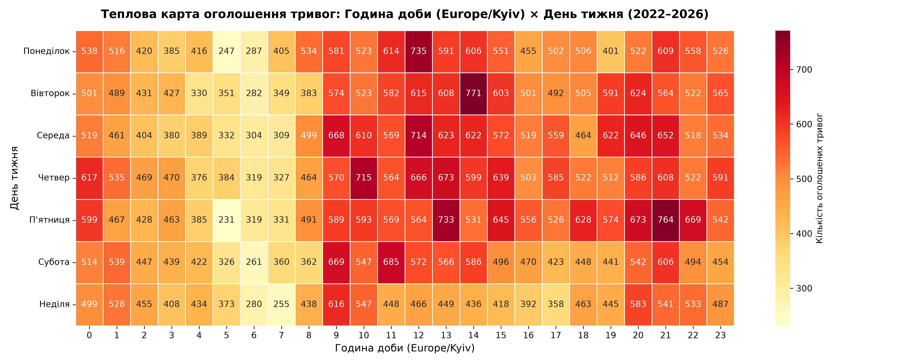
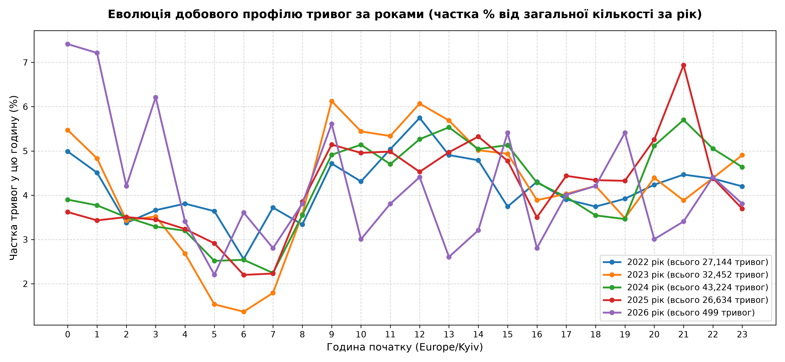
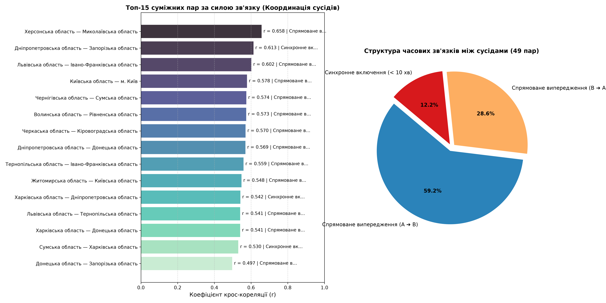
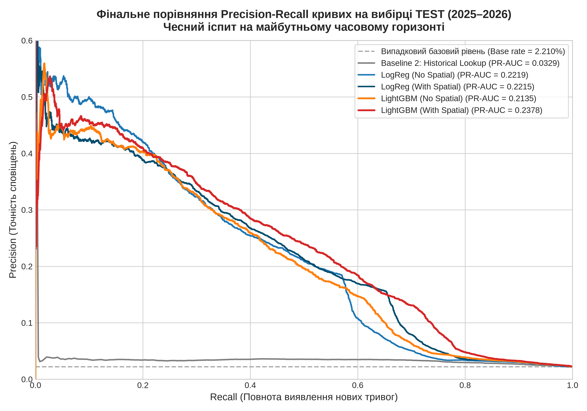
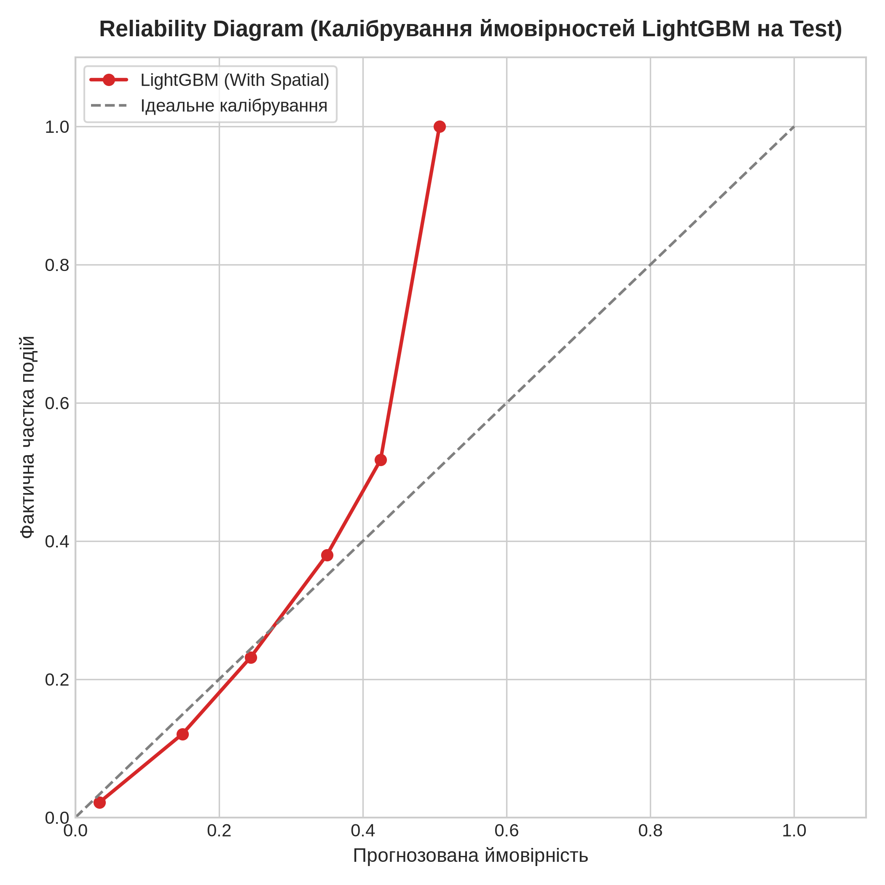
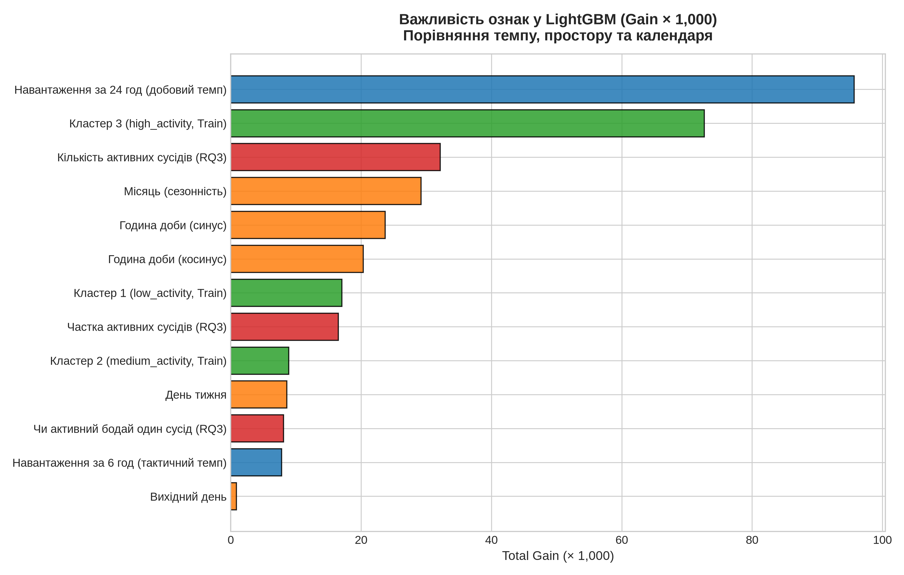

# 🚨 Analysis & Short-Term Forecasting of Ukrainian Air Raid Sirens (2022–2026)

[ **🇺🇦 Українська версія** ](README.md) | [ **🇬🇧 English Version** ](README_EN.md)

[](https://www.python.org/)
[](LICENSE)
[](https://github.com/Vadimkin/ukrainian-air-raid-sirens-dataset)
[](https://parquet.apache.org/)
[](reports/ml_models_benchmark.csv)
[](tests/test_leakage_invariance.py)

A comprehensive data science and machine learning research project analyzing the spatial-temporal dynamics of air raid sirens across Ukraine (March 15, 2022 – September 5, 2026) using officially verified open records.

The repository bridges **exploratory time series analysis (EDA, RQ1–RQ3)** and a **rigorous causal machine learning system (ML)** designed to forecast the onset of new alerts during periods of calm ($T \to T+1$h).

> **Data Source Verification:**  
> Sourced from the official verified archive [Vadimkin/ukrainian-air-raid-sirens-dataset](https://github.com/Vadimkin/ukrainian-air-raid-sirens-dataset) (upstream commit 08.09.2026).  
> Raw data file hash (`data/raw/official_data_uk.csv`):  
> `SHA-256: 1f50085481d229f57b624d83b1ce723e884dea409c14afb5b7040c8a2f233e4f` (Git blob: `71d70c0ca54968f530d596cf315616fa858800e1`).

---

## 📑 Table of Contents
1. [Key Findings from Exploratory Analysis (RQ1–RQ3)](#-key-findings-from-exploratory-analysis-rq1rq3)
2. [Machine Learning: Alert Onset Forecasting](#-machine-learning-alert-onset-forecasting)
3. [Intuitive Interpretation: How the Predictions Work](#-intuitive-interpretation-how-the-predictions-work)
4. [Ablation Study: Quantifying Spatial Propagation](#-ablation-study-quantifying-spatial-propagation)
5. [Causal Integrity & Zero Data Leakage](#-causal-integrity--zero-data-leakage)
6. [Quickstart Guide](#-quickstart-guide)
7. [Repository Structure](#-repository-structure)

---

## 🔬 Key Findings from Exploratory Analysis (RQ1–RQ3)

### 1. Temporal Cyclicity (RQ1)
* **Weekly Pattern (Kruskal-Wallis Test):** $H = 13.72, \ p = 0.033$. Statistically significant inter-day variation. Peak alert activity occurs Wednesday–Friday (median 92–94 alerts/day nationally), dropping to a minimum on Sunday (78 alerts/day, $-15\%$).
* **Temporal Shift (Evolution 2022 ➔ 2026):** In 2022, attack activity concentrated during daylight hours (09:00–19:00). In 2024–2026, systematic Shahed-136 loitering munition waves created an enduring nighttime plateau (00:00–05:00), raising the nocturnal alert share from **$20.2\%$ to $30.7\%$**.
* **Alert Duration:** Median duration is **40.4 minutes**, while the arithmetic mean is **79.7 minutes** (heavy right-tailed distribution caused by prolonged strategic aviation operations).

<p align="center">
  
  <br><em>Figure 1. Heatmap of alert intensity across hours of the day and days of the week (24×7).</em>
</p>

<p align="center">
  
  <br><em>Figure 2. Yearly shift from daylight raid peaks (2022) to nighttime drone barrage plateaus (2024–2026).</em>
</p>

---

### 2. Regional Safety Clusters (RQ2)
Hierarchical agglomerative clustering (Ward linkage, Euclidean distance on 5 standardized burden features, Silhouette score = 0.385) identified 3 geographic macro-zones across Ukraine:
* **Cluster 1 (Deep Rear, 11 oblasts):** Western Ukraine + Zhytomyr, Kyiv, Vinnytsia. Average monthly burden: 38.4 alerts/month.
* **Cluster 2 (Transit Central / North, 11 oblasts):** Center, North, South, and Kyiv City. Average monthly burden: 144.9 alerts/month; characterized by brief alerts ($\le 30$ min) driven by ballistic warnings.
* **Cluster 3 (Frontline Zone, 2 oblasts):** Donetsk and Sumy. Average monthly burden: 203.8 alerts/month; $>30\%$ of alerts exceed 2 hours due to tactical aviation and guided aerial bomb (KAB) coverage.

<p align="center">
  
  <br><em>Figure 3. Ward hierarchical dendrogram clustering all 24 administrative regions of Ukraine.</em>
</p>

---

### 3. Spatial Threat Propagation Routes (RQ3)
* Isolated $>1,000$ hours of synchronized nationwide alerts ($\ge 15$ oblasts simultaneously during MiG-31K takeoffs) to eliminate spurious zero-latency artifacts.
* Across a network graph of 49 directly adjacent oblast pairs, lead-lag cross-correlations revealed physical flight delays of **10–20 minutes** along primary transit vectors (Khmelnytskyi ➔ Vinnytsia $r=0.45$, Cherkasy ➔ Kirovohrad $r=0.60$).

<p align="center">
  
  <br><em>Figure 4. Cross-correlation lead-lag flight delays between contiguous regions along typical flight corridors.</em>
</p>

---

## 🤖 Machine Learning: Alert Onset Forecasting

### Problem Formulation
* **Calm-Period Conditioning:** Predictions are generated strictly when no siren is active in the region (`is_active_T == 0`).
* **Target:** Predict whether an alert starts in the upcoming one-hour window $(T, T+1\text{h}]$: $y_T = 1$.
* **Causal Features:** All indicators are computed over historical rolling windows $[T-k, T]$ strictly closed on the left (`closed='left'`).
* **Leakage-Free Clustering:** For ML features, regional clusters are trained **strictly on the Train set (2022–2024)** (`reports/clusters_train_only.csv`).

### Final Test Benchmark (Test: 2025–2026)
*Evaluated on 254,830 calm hourly periods, with 5,631 true alert onsets (positive base rate $2.21\%$).*

| Model | Feature Set | Threshold $p^*$ (from Val) | Test PR-AUC [95% CI] | Test $F_2$-Score [95% CI] | Precision | Recall | Brier Score |
| :--- | :--- | :---: | :---: | :---: | :---: | :---: | :---: |
| **Baseline 1: True Naive** | Lagged onset at $T-1$ | 0.500 | — | 0.0686 | 18.3% | 5.9% | 0.0267 |
| **Baseline 2: Historical Lookup** | Historical rate (Kyiv time) | 0.085 | 0.0334 [0.031, 0.036] | 0.1421 [0.140, 0.146] | 3.4% | 67.7% | 0.0273 |
| **Baseline 3: Adaptive 14-day** | 14-day rolling rate | 0.089 | 0.2205 [0.214, 0.227] | **0.4001** [0.390, 0.407] | 17.7% | 58.4% | **0.0189** |
| **LogReg (No Spatial)** | Time + Intensity | 0.521 | 0.2219 [0.215, 0.228] | 0.2423 [0.239, 0.248] | 6.9% | 65.7% | 0.1734 |
| **LogReg (With Spatial)** | Time + Intensity + Neighbors | 0.572 | 0.2215 [0.215, 0.228] | 0.4000 [0.392, 0.407] | 16.7% | 61.5% | 0.1612 |
| **LightGBM (No Spatial)** | Time + Intensity | 0.093 | 0.2135 [0.207, 0.220] | 0.3354 [0.329, 0.342] | 11.6% | 63.3% | 0.0208 |
| **LightGBM (With Spatial)** | Time + Intensity + Neighbors | 0.105 | **0.2378** [0.231, 0.245] | 0.3823 [0.375, 0.390] | 13.8% | **68.5%** | 0.0203 |

<p align="center">
  
  <br><em>Figure 5. Precision-Recall curves on Test (2025–2026). LightGBM With Spatial achieves top PR-AUC = 0.2378.</em>
</p>

---

## 💡 Intuitive Interpretation: How the Predictions Work

1. **Background Rate vs. Alert Spikes:**
   In an arbitrary calm hour, the chance of a siren starting in the subsequent hour is only **~2.2–2.4%** (1 in 40 class imbalance). During quiet hours, model predictions remain between $0.5\% – 1.5\%$.
2. **Threat Surge Detection:**
   When nocturnal drone strikes begin and neighboring border regions trigger alerts, the model elevates risk assessments for downstream transit regions up to **$15\% – 35\%+$**.
3. **Operational Threshold $p^* = 0.105$ (10.5%):**
   In civil defense and early warning, missing an attack is far costlier than a false alarm ($F_2$ optimization prioritizing $Recall$ over $Precision$):
   * The model successfully detects **68.5% (nearly 7 in 10)** of all impending alert onsets.
   * Among all raised warnings, **13.8%** result in sirens, representing a **~6x concentration of risk** over the baseline background rate ($2.2\%$). When the model issues an alert, danger is 6 times higher than normal.
4. **Probability Calibration:**
   A Brier Score of **0.0203** reflects robust probability calibration across the spectrum.

<p align="center">
  
  <br><em>Figure 6. Reliability curve and predicted probability distribution for LightGBM.</em>
</p>

---

## 🛰️ Ablation Study: Quantifying Spatial Propagation

A controlled experiment examining the isolated contribution of spatial neighbor features (alert activity in contiguous regions across 1, 3, and 6 hours + regional activity clusters):
* **Gradient Boosted Trees (LightGBM):**  
  Spatial features deliver a statistically significant improvement: **PR-AUC increases from 0.2135 to 0.2378** ($+11.4\%$ relative gain; 95% Bootstrap CIs $[0.207, 0.220]$ vs. $[0.231, 0.245]$ do not overlap).
* **Linear Logistic Regression:**  
  PR-AUC remains static ($0.2219 \to 0.2215$), but spatial indicators stabilize threshold tuning, elevating Precision from 6.9% to 16.7%.
* **Scientific Takeaway:** Threat propagation across Ukraine exhibits **complex, non-linear spatial interactions** that are effectively captured by decision tree ensembles rather than linear models.

<p align="center">
  
  <br><em>Figure 7. Top-15 most influential predictors in LightGBM ranked by total information gain.</em>
</p>

#### Primary Risk Drivers:
1. `burden_last_24h` (Gain 95.7k) — Rolling 24-hour national attack intensity.
2. `cluster_3_high_activity` (Gain 72.7k) — Region location in the high-intensity eastern/southern zone.
3. `neighbors_active_count` (Gain 32.1k) — Number of adjacent regions currently experiencing active alerts (outweighs time of day).

---

## 🛡️ Causal Integrity & Zero Data Leakage

Methodological validity is enforced via strict engineering protocols:
1. **Strict Chronological Splits:**
   * **Train (47.9%):** 15.03.2022 – 30.04.2024 (410,150 rows).
   * **Validation (22.2%):** 01.05.2024 – 31.05.2025 (190,195 rows).
   * **Test (29.8%):** 01.06.2025 – 05.09.2026 (254,830 rows).
2. **2-Hour Embargo Buffer:** Excludes transitional boundary records so that forecasting target intervals never cross split partitions.
3. **Train-Only Clustering:** ML cluster weights are fitted strictly on Train data prior to April 30, 2024 (`reports/clusters_train_only.csv`).
4. **Calm-Conditioned Scope:** Models are evaluated solely when sirens are inactive at $T$ (`is_active_T == 0`).
5. **Causal Active Status:** Eliminates retrospective `is_finished` indicators (zero knowledge of future alert end times).
6. **Automated Invariance Verification (`tests/test_leakage_invariance.py`):**  
   At randomly sampled timestamps $T$, raw input data is physically truncated at $T$, features are recomputed from scratch, and compared against the Feature Store. The test confirms 100% numerical invariance.

---

## 🚀 Quickstart Guide

### 1. Clone & Set Up Environment
```bash
git clone https://github.com/Yaroo-a/ukrainian-air-raid-sirens-analysis.git
cd ukrainian-air-raid-sirens-analysis
python -m venv .venv
source .venv/bin/activate
pip install -r requirements.txt
```

### 2. Run Interactive Notebooks
```bash
jupyter lab
```
* `notebooks/01_data_profiling_and_cleaning.ipynb` — Data profiling, type casting, and sanity audits.
* `notebooks/02_rq1_temporal_cyclicity.ipynb` — Weekly/diurnal patterns & Kruskal-Wallis testing.
* `notebooks/03_rq2_regional_clustering.ipynb` — Regional vulnerability profiling & agglomerative clustering.
* `notebooks/04_rq3_spatial_propagation_routes.ipynb` — Lead-lag cross-correlations between adjacent regions.
* `notebooks/05_ml_forecasting_experiment.ipynb` — End-to-end ML: feature generation, baselines, and ablation.

### 3. Execute Automated Pipeline
```bash
# Run data leakage invariance test
python tests/test_leakage_invariance.py

# Generate features, train models, and evaluate on Test
python src/features/feature_store.py
python src/models/baselines.py
python src/models/train_models.py
python src/models/evaluate_test.py
```

---

## 📁 Repository Structure

```
├── data/
│   ├── raw/official_data_uk.csv               # Raw alert logs (read-only, SHA-256 verified)
│   └── processed/
│       ├── alerts_clean_oblast.parquet        # Cleaned alert records (129,955 rows)
│       └── ml_features_hourly.parquet         # Calm-period Feature Store (855,175 rows)
├── models/                                    # Model weights (LightGBM, LogReg, scalers, tuned thresholds p*)
├── notebooks/                                 # 5 interactive research Jupyter Notebooks
├── reports/
│   ├── figures/                               # 13 high-resolution publication charts (300 DPI)
│   ├── clusters_train_only.csv                # Train-only clustering for ML features
│   ├── regional_clusters_summary.csv          # Regional summary profiles (RQ2)
│   ├── spatial_lead_lag_summary.csv           # Lead-lag delay matrices (RQ3)
│   ├── baselines_benchmark.csv                # Baseline performance benchmarks
│   ├── ml_validation_benchmark.csv            # Validation benchmarks & threshold tuning
│   ├── ml_models_benchmark.csv                # Final Test set benchmark with 95% Bootstrap CIs
│   └── feature_importance_lightgbm.csv        # LightGBM feature gain ranking
├── src/
│   ├── data/cleaner.py                        # Cleaning and typing pipeline
│   ├── features/
│   │   ├── cyclicity.py                       # Temporal cycle extraction
│   │   ├── clustering.py                      # Regional clustering algorithms
│   │   ├── propagation.py                     # Spatial lags & adjacency graph
│   │   └── feature_store.py                   # Hourly Feature Store generator for ML
│   └── models/
│       ├── baselines.py                       # Naive, historical lookup, and 14-day rolling baselines
│       ├── train_models.py                    # Model training, spatial ablation, threshold tuning
│       └── evaluate_test.py                   # Test evaluation, Bootstrap CIs, reliability curves
├── tests/
│   ├── verify_pipeline.py                     # Pipeline sanity check
│   └── test_leakage_invariance.py             # Physical truncation data leakage test
├── requirements.txt                           # Environment dependencies
├── LICENSE                                    # MIT License
├── README.md                                  # Ukrainian documentation (Default)
└── README_EN.md                               # English documentation
```

---

## 🛠️ Technology Stack
* **Language:** Python 3.14
* **Data Processing & Analytics:** Pandas, NumPy, SciPy, Statsmodels, PyArrow
* **Machine Learning:** Scikit-learn, LightGBM
* **Visualization:** Matplotlib, Seaborn, Plotly
* **Storage Format:** Apache Parquet (Snappy compression)

---

## 📄 License
Released under the [MIT License](LICENSE).  
Data originates from the open verified archive [alerts.in.ua / Vadimkin](https://github.com/Vadimkin/ukrainian-air-raid-sirens-dataset).
