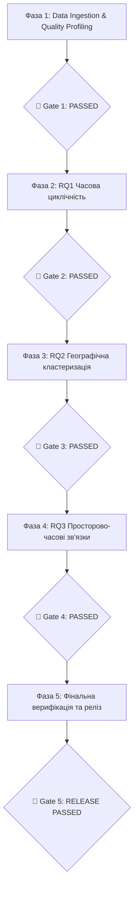

# Дорожня карта проєкту (Roadmap) та Quality Gates

> **Статус проєкту:** ВСІ 5 ФАЗ УСПІШНО ЗАВЕРШЕНО (Quality Gates 1–5: PASSED)  
> **Дата оновлення:** Жовтень 2026  
> **Проєкт:** «Аналіз часових рядів повітряних тривог в Україні (2022–2026)»

---

## Загальна схема виконання

---

## Статус проходження Quality Gates

| Фаза | Назва етапу | Головні результати | Статус Quality Gate |
| :--- | :--- | :--- | :---: |
| **Фаза 1** | **Data Ingestion & Profiling** | 129,955 рядків Parquet, 25 областей, часовий пояс Europe/Kyiv, 0 від'ємних тривалостей, хронологічний спліт (Train/Val/Test). | ✅ **Gate 1: PASSED** |
| **Фаза 2** | **RQ1: Часова циклічність** | Kruskal-Wallis $p = 0.033$, попарний тест Бонферроні на 21 пару, графік 24x7, нічний зсув до 30.7%, медіана 40.4 хв. | ✅ **Gate 2: PASSED** |
| **Фаза 3** | **RQ2: Географічна кластеризація** | 5 ознак цифрового паспорта, оптимум $K=3$ за Silhouette Score (0.3851), дендрограма Ward, 3 кластери (Тил, Центр, Фронт). | ✅ **Gate 3: PASSED** |
| **Фаза 4** | **RQ3: Просторово-часові зв'язки** | 49 сухопутних пар, 1024.5 год синхронних спалахів ізольовано, Lead Time розраховано для всіх пар, 2-панельний графік. | ✅ **Gate 4: PASSED** |
| **Фаза 5** | **Фіналізація та відтворюваність** | Автоматичний тест `tests/verify_pipeline.py` успішний, 4 блокноти, 6 графіків DPI 300, 2 CSV-звіти, вичерпний `README.md`. | 🏁 **Gate 5: PASSED** |

---

## Підсумковий стек артефактів проєкту

1. **База даних:** `data/processed/alerts_clean_oblast.parquet` (129,955 записів).
2. **Програмні модулі:** `src/data/cleaner.py`, `src/features/cyclicity.py`, `src/features/clustering.py`, `src/features/propagation.py`.
3. **Звіти та візуалізації:** `reports/figures/01`–`06`, `reports/regional_clusters_summary.csv`, `reports/spatial_lead_lag_summary.csv`.
4. **Дослідницькі блокноти:** `notebooks/01_data_profiling_and_cleaning.ipynb` — `04_rq3_spatial_propagation_routes.ipynb`.
5. **Тести та автоматизація:** `tests/verify_pipeline.py`.
6. **Документація:** `README.md`, `документи/методологія_та_правила_проекту.md`, `документи/roadmap.md`.
