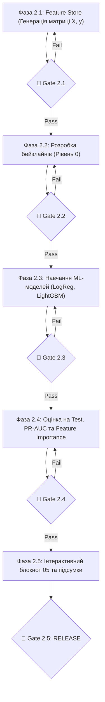

# Дорожня карта Етапу 2 (Roadmap): Машинне навчання та прогнозування тривог

> **Статус документа:** Затверджений покроковий план реалізації Етапу 2  
> **Дата створення:** Жовтень 2026  
> **Мета:** Створення повноцінного ML-пайплайну часових рядів, розробка бейзлайнів, тренування моделей машинного навчання та оцінка внеску просторових лагів.

---

## Загальна схема виконання Етапу 2

---

## Детальний опис фаз, Quality Gates та метрик Етапу 2

---

### 📍 Фаза 2.1: Побудова Feature Store (Генерація матриці ознак)
* **Мета:** Створити регулярну годинну таблицю $X, y$ з точними односторонніми лагами та просторовими ознаками сусідів.
* **Задачі:**
  1. Розбиття часової осі на 1-годинні слоти для кожної області (2022–2026).
  2. Генерація цільової змінної Onset: $y_{i, t+1} \in \{0, 1\}$ (початок нової тривоги в наступні 1–2 години).
  3. Розрахунок циклічних ознак часу ($\sin/\cos$ години, день тижня, вихідні).
  4. Розрахунок просторових ознак сусідів: кількість активних сусідів на момент $t$, зважений індекс тиску сусідів з RQ3.
  5. Розрахунок авторегресійних лагів ($y_{t-1}$, частка тривог за останні 6 та 24 години).
  6. Збереження результату у форматі Parquet: `data/processed/ml_features_hourly.parquet`.
* **🚦 Quality Gate 2.1 (Критерії пропуску):**
  * [ ] Файл `data/processed/ml_features_hourly.parquet` успішно створено.
  * [ ] **0% пропусків у часі:** кожен часовий крок має строго хронологічний порядок.
  * [ ] **Zero Target Leakage:** жодна ознака $X_t$ не містить інформації з майбутнього $t+1$ (усі лаги зі зсувом `shift(1)`).
  * [ ] Збережено колонку `split_set` (Train / Val / Test).

---

### 📍 Фаза 2.2: Розробка бейзлайнів (Рівень 0 — Без машинного навчання)
* **Мета:** Задати точку відліку, яку зобов'язані перевершити моделі машинного навчання.
* **Задачі:**
  1. Реалізація **Naive Persistence Baseline**: $\hat{y}_{t+1} = y_t$ (у наступну годину буде те саме).
  2. Реалізація **Historical Lookup Baseline**: розрахунок таблиці емпіричних імовірностей на Train за ключем:
     $$P(\text{тривога} \mid \text{день\_тижня}, \text{година}, \text{кластер})$$
  3. Розрахунок базових метрик ($Recall$, $Precision$, $F_2$, $PR\text{-}AUC$) для бейзлайнів на Validation вибірці.
* **🚦 Quality Gate 2.2 (Критерії пропуску):**
  * [ ] Обидва бейзлайни реалізовано у модулі `src/models/baselines.py`.
  * [ ] Отримано точні числові значення $F_2$ та $PR\text{-}AUC$ для бейзлайнів на вибірці Validation.
  * [ ] Зафіксовано базову планку якості: «мінімальний поріг для входу в ML».

---

### 📍 Фаза 2.3: Навчання моделей машинного навчання та тюнінг порогів
* **Мета:** Навчити прозору Логістичну регресію та градієнтний бустинг LightGBM на Train, підібрати оптимальні пороги класифікації на Validation.
* **Задачі:**
  1. Навчання **Логістичної регресії** з `class_weight='balanced'` та регуляризацією L2.
  2. Навчання **LightGBM** з оптимізацією функції втрат для дисбалансу (`scale_pos_weight`).
  3. Побудова Precision-Recall кривої на вибірці Validation.
  4. Підбір оптимального порогу класифікації $p^* = \arg\max_p F_2(p)$ на Validation.
* **🚦 Quality Gate 2.3 (Критерії пропуску):**
  * [ ] Моделі успішно сходяться без перенавчання (рання зупинка `early_stopping` на Validation).
  * [ ] Оптимальний поріг $p^*$ знайдено виключно на Validation (жодного торкання Test).
  * [ ] Модуль `src/models/train_models.py` успішно протестовано.

---

### 📍 Фаза 2.4: Фінальна оцінка на Test (2025–2026) та аналіз важливості ознак
* **Мета:** Провести чесний екзамен моделей на контрольному періоді Test та відповісти на питання: *«Що важливіше — час чи сусіди?»*.
* **Задачі:**
  1. Оцінка моделей на вибірці Test із зафіксованим порогом $p^*$.
  2. Розрахунок **Lift over Baseline** (відносний приріст якості ML порівняно з бейзлайнами):
     $$\text{Lift} = \frac{F_2(\text{LightGBM}) - F_2(\text{Baseline})}{F_2(\text{Baseline})} \times 100\%$$
  3. Побудова графіка **Feature Importance (Gain)** для LightGBM: оцінка внеску просторових лагів сусідів проти добової циклічності.
  4. Генерація графіків:
     * `reports/figures/07_pr_curves_comparison.png` (порівняння PR-кривих усіх моделей).
     * `reports/figures/08_feature_importance_lightgbm.png` (фактори впливу).
* **🚦 Quality Gate 2.4 (Критерії пропуску):**
  * [ ] Результати на Test зафіксовано в підсумковій таблиці `reports/ml_models_benchmark.csv`.
  * [ ] Графік Feature Importance збережено у високій якості.
  * [ ] Отримано однозначну математичну відповідь щодо користі просторових лагів.

---

### 📍 Фаза 2.5: Інтерактивний блокнот 05 та фінальна фіксація
* **Мета:** Оформити весь експеримент у зрозумілий інтерактивний блокнот та оновити документацію.
* **Задачі:**
  1. Створення блокнота `notebooks/05_ml_forecasting_experiment.ipynb`.
  2. Оновлення головного `README.md` з розділом про результати машинного навчання.
  3. Перевірка повної відтворюваності: прогін усього ML-пайплайну з нуля.
* **🚦 Quality Gate 2.5 (Фінальний реліз):**
  * [ ] Блокнот `05` виконується без жодної помилки.
  * [ ] Результати змагання моделей задокументовані з науковими висновками.
