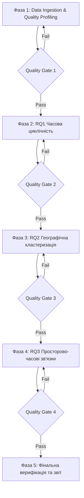

# Методологія, архітектура та правила проєкту: Аналіз часових рядів повітряних тривог в Україні

> **Статус документа:** Затверджена повна науково-інженерна специфікація проєкту (MVP)  
> **Дата оновлення:** Жовтень 2026  
> **Призначення:** Єдине джерело правди (Single Source of Truth) для постановки задач, математичного апарату, правил обробки даних, дорожньої карти (Roadmap) та критеріїв якості (Quality Gates).

---

## 1. Головні дослідницькі питання (Research Questions)

* **RQ1 (Часова циклічність):**  
  *Чи існує стійка добова (нічні vs денні нальоти) та тижнева циклічність повітряних тривог в Україні, і як ці патерни трансформувалися в динаміці з 2022 по 2026 рік? Чи є відмінності між днями тижня статистично значущими ($p < 0.05$), чи це випадковий шум?*
* **RQ2 (Географічна типізація та кластеризація):**  
  *Як принципово відрізняються профілі загроз для різних регіонів (глибокий тил на зразок Закарпаття, транзитний центр на зразок Київщини, прифронтові східні та південні області), і на яку оптимальну кількість кластерів $K$ ділиться безпекова карта України на основі дендрограми та метрик якості кластеризації (Silhouette Score, Davies-Bouldin)?*
* **RQ3 (Просторово-часові зв'язки та маршрути загроз):**  
  *Чи можна на основі взаємних часових затримок (lead-lag cross-correlation) між безпосередньо суміжними областями відновити типові просторово-часові ланцюжки поширення тривог («хвилі» підльоту), ізолювавши при цьому синхронні загальнонаціональні тривоги?*

---

## 2. Дані та конвеєр очищення (Data Pipeline)

### 2.1. Фактичні параметри сирого датасету
* **Джерело:** `data/raw/official_data_uk.csv` (Vadimkin GitHub dump).
* **Фактичний обсяг:** 299 275 сирих рядків.
* **Часовий діапазон:** з **15 березня 2022** року по **5 вересня 2026** року (понад 4.5 роки щоденних спостережень).
* **Колонки:** `oblast`, `raion`, `hromada`, `level`, `started_at`, `finished_at`, `source`.

### 2.2. Географічна деталізація
* Для аналізу відбираються записи виключно з:
  $$\text{level} == \text{'oblast'}$$
  (130 235 рядків).
* *Обґрунтування:* До грудня 2025 року система не фіксувала тривоги на рівні районів/громад. Змішування рівнів порушує порівнюваність часових рядів за роками.

### 2.3. Правила фільтрації та обробки аномалій
1. **Пропуски часу відбою (`finished_at.isna()`):**
   * Маркуються прапорцем `is_finished = False`. Враховуються при підрахунку кількості оголошених тривог, але виключаються з розрахунку метрик тривалості.
2. **Дублікати:**
   * Перевіряються за ключем `[oblast, started_at]`. Повні дублікати видаляються.
3. **Технічні мікро-тривоги ($< 60$ секунд):**
   * Видаляються як технічні збої сирен / тестування обладнання (у датасеті виявлено рівно 280 таких записів).
4. **Окуповані території та зони бойових дій (ТОТ):**
   * Луганська область, АР Крим та м. Севастополь маркуються `is_occupied_extreme = True`. Їхні аномально довгі записи (безперервні тривоги тривалістю в місяці/роки) **ізолюються** від загальнонаціональних підрахунків середнього та медіан.
5. **Часові пояси (Timezone):**
   * Зберігання: внутрішній стандарт **UTC** (`+00:00`).
   * Дослідження добових та тижневих патернів: конвертація в `Europe/Kyiv` з автоматичним урахуванням літнього (+3) та зимового (+2) часу.
6. **Збереження результату:**
   * Скрипт очищення зберігає результат у `data/processed/alerts_clean_oblast.parquet` із суворою схемою типів даних (Apache Parquet, Snappy compression).

---

## 3. Математичний апарат для RQ1 (Часова циклічність)

### 3.1. Визначення аналітичних показників
* **Інтенсивність:** Кількість нових оголошених тривог за годину / добу.
* **Навантаження (Burden Ratio):** Частка часу перебування області під тривогою $p \in [0, 1]$.

### 3.2. Статистичні гіпотези (Kruskal-Wallis)
Порівнюються 7 незалежних груп за днями тижня ($k=7$):
* **$H_0$ (Нульова гіпотеза):** Розподіл щоденної кількості тривог однаковий для всіх 7 днів тижня (медіани рівні, різниця є випадковим шумом).
* **$H_1$ (Альтернативна гіпотеза):** Щонайменше для одного дня тижня розподіл кількості тривог статистично відрізняється від інших.
* **Обґрунтування тесту:** Кількість щоденних тривог є дискретною лічильною величиною (count data) з правосторонньою асиметрією. Параметричний тест ANOVA непридатний через порушення вимоги нормальності розподілу (тест Шапіро-Вілка $p < 0.001$). Використовується непараметричний $H$-тест Крускала-Волліса.
* **Post-hoc аналіз:** У разі відхилення $H_0$ ($p < 0.05$) проводиться попарне порівняння за тестом Манна-Вітні з **поправкою Бонферроні** для контролю групової ймовірності помилки I роду ($\alpha_{\text{adj}} = \frac{0.05}{21} \approx 0.00238$) або Benjamini-Hochberg FDR.

### 3.3. Розподіл тривалості та сезонність
* Побудова емпіричного розподілу тривалості (KDE + гістограма). Розрахунок робастних квантилів: $Q_{25}, Q_{50} \text{ (медіана)}, Q_{75}, Q_{95}$.
* Порівняння річних добових профілів (2022 vs 2023 vs 2024 vs 2025 vs 2026): нормалізація частки тривог кожної години відносно загальної кількості за відповідний рік ($\%$) для виявлення чистої зміни тактики ворога (нічні нальоти БПЛА vs денні ракетні удари).

---

## 4. Математичний апарат для RQ2 (Географічна кластеризація)

### 4.1. Географічні одиниці
24 регулярні адміністративні одиниці (23 області підконтрольної території + м. Київ). Окуповані регіони з нескінченними тривогами виключені для уникнення деформації ознакового простору.

### 4.2. Вектор ознак області (Digital Passport)
Для кожного регіону $i$ формується 5-вимірний нормалізований вектор:
1. `alerts_per_month`: середня кількість тривог за 30.5 календарних днів.
2. `median_duration_min`: медіанна тривалість однієї тривоги (хвилини).
3. `night_ratio`: частка тривог, що розпочалися між 00:00 та 05:59.
4. `short_ratio`: частка тривог тривалістю $\le 30$ хв (балістика, тактична авіація).
5. `long_ratio`: частка тривог тривалістю $\ge 120$ хв (масовані дронові нальоти).

### 4.3. Алгоритм та стандартизація
* **StandardScaler:** обов'язкове z-масштабування ($z = \frac{x - \mu}{\sigma}$), оскільки ознаки мають різні масштаби вимірювання (хвилини, частки від 0 до 1, штуки).
* **Ієрархічна агломеративна кластеризація (Ward Linkage):** метод мінімальної дисперсії Варда мінімізує суму квадратів відхилень усередині створюваних кластерів.

### 4.4. Визначення оптимальної кількості кластерів $K$
Кількість кластерів **не закріплюється заздалегідь**, а обирається на основі аналізу:
1. **Silhouette Score:** оцінка відокремленості кластерів для $K \in [2, 6]$ (максимізація $S$).
2. **Davies-Bouldin Index:** відношення внутрішньокластерного розсіювання до міжкластерної відстані (мінімізація $DB$).
3. **Дендрограма (SciPy):** візуальний вибір лінії зрізу за найбільшою відстанню між злиттями гілок.

---

## 5. Математичний апарат для RQ3 (Просторово-часові зв'язки)

### 5.1. Дискретизація просторово-часового ряду
* Для кожної області будується бінарний часовий ряд $x_i(t) \in \{0, 1\}$ з постійним кроком **$\Delta t = 10$ хвилин**.
* *Фізичне обґрунтування:* 10 хвилин відповідає типовому часу підльоту повітряних цілей між сусідніми областями (крилаті ракети зі швидкістю ~800 км/год долають ~130 км; дрони зі швидкістю ~180 км/год долають ~30 км).

### 5.2. Матриця географічного сусідства (Adjacency Matrix)
Аналіз взаємного поширення проводиться **виключно для пар областей зі спільним сухопутним кордоном** ($Adj(i, j) = 1$). Аналіз несуміжних областей (наприклад, Закарпаття і Харків) відкидається для запобігання транзитивним хибним кореляціям.

### 5.3. Крос-кореляція та розрахунок Lead Time
Для кожної суміжної пари $(A, B)$ обчислюється функція крос-кореляції:
$$R_{AB}(\tau) = \frac{\sum_{t} (x_A(t) - \bar{x}_A)(x_B(t + \tau) - \bar{x}_B)}{\sigma_A \sigma_B}$$
для лагів $\tau \in [-180, +180]$ хвилин з кроком 10 хвилин.
* Лаг $\tau^* = \arg\max_\tau R_{AB}(\tau)$ визначає типовий час випередження (**Lead Time**).

### 5.4. Фільтрація синхронних загальнонаціональних тривог
* *Методологічна пастка:* Зліт МіГ-31К або пуск балістики активує сирени у 15+ областях одночасно протягом 2 хвилин. Якщо ці події не відфільтрувати, алгоритм покаже «миттєве поширення за 0 хвилин» між усіма областями країни.
* *Фільтр:* Інтервали часу, коли протягом вікна у 10 хвилин тривога вмикається у $\ge 15$ областях одночасно, маркуються як **«Загальнонаціональні синхронні»** та **виключаються** з розрахунку локального графа розповсюдження.

### 5.5. Обмеження інтерпретації
Граф затримок відображає **статистичну послідовність оголошення сповіщень**, а не безперервний фізичний радіолокаційний трек повітряного об'єкта.

---

## 6. Рішення щодо розділу «Прогнозування»

* **Рішення:** **Прогнозування повністю виключено з рамок проєкту (Out of Scope).**
* *Обґрунтування:* Рішення про нанесення ударів та оголошення тривог ухвалюються військовим командуванням і залежать від політичних, логістичних та розвідувальних факторів, яких немає у відкритому ряді сирен. Будь-які класифікатори «чи буде тривога завтра» на суто часовому ряді без зовнішніх розвідданих мають нульову практичну цінність.
* Проєкт зосереджується виключно на науково обґрунтованому **Описовому та Діагностичному аналізі (Exploratory & Diagnostic Analysis)**.

---

## 7. Структура коду та блокнотів

```
/home/yarooo/Projects/Agentic/
├── data/
│   ├── raw/                  # Сирі CSV-файли (read-only)
│   │   ├── official_data_uk.csv
│   │   └── official_data_en.csv
│   └── processed/            # Очищені дані Parquet
│       └── alerts_clean_oblast.parquet
├── документи/
│   └── методологія_та_правила_проекту.md
├── notebooks/                # Дослідницькі Jupyter Notebooks
│   ├── 01_data_profiling_and_cleaning.ipynb
│   ├── 02_rq1_temporal_cyclicity.ipynb
│   ├── 03_rq2_regional_clustering.ipynb
│   └── 04_rq3_spatial_propagation_routes.ipynb
├── src/                      # Чисті модульні Python-скрипти
│   ├── data/cleaner.py
│   ├── features/cyclicity.py
│   ├── features/clustering.py
│   └── features/propagation.py
└── reports/figures/          # Збережені графіки високої роздільної здатності (DPI 300)
```

---

## 8. Дорожня карта проєкту (Roadmap) та критерії якості (Quality Gates)

Проєкт виконується за 5 послідовними етапами. Перехід до наступного етапу можливий **лише після проходження відповідного Quality Gate**.



### Фаза 1. Data Ingestion & Cleaning
* **Задачі:** Створення віртуального оточення, фільтрація `level=='oblast'`, перетворення типів, фільтрація глітчів $< 60$с, маркування ТОТ, збереження в Parquet.
* 🚦 **Quality Gate 1:**
  * [ ] Файл `alerts_clean_oblast.parquet` створено й він читається без помилок.
  * [ ] Кількість рядків після фільтрації становить $\approx 130\,000$ (відповідає областям).
  * [ ] 0 рядків із від'ємною тривалістю (`finished_at < started_at`).
  * [ ] Часовий пояс `Europe/Kyiv` коректно розраховано для 100% записів.

### Фаза 2. RQ1 — Часова циклічність
* **Задачі:** Розрахунок теплової карти $24 \times 7$, проведення тесту Крускала-Волліса, аналіз динаміки тривалостей, побудова графіків еволюції 2022–2026.
* 🚦 **Quality Gate 2:**
  * [ ] Отримано $p$-value тесту Kruskal-Wallis із чітким висновком про значущість днів тижня.
  * [ ] У разі $p < 0.05$ застосовано попарний тест із поправкою Бонферроні.
  * [ ] Згенеровано та збережено 3 графіки у `reports/figures/` (теплова карта $24 \times 7$, еволюція за роками, розподіл тривалості).
  * [ ] Результати оформлено в `notebooks/02_rq1_temporal_cyclicity.ipynb`.

### Фаза 3. RQ2 — Географічна кластеризація
* **Задачі:** Розрахунок 5 ознак цифрового паспорта для 24 регіонів, z-масштабування, ієрархічна кластеризація методом Варда, перебір $K \in [2, 6]$ з оцінкою Silhouette Score та Davies-Bouldin.
* 🚦 **Quality Gate 3:**
  * [ ] Побудовано матрицю $24 \times 5$ без пропусків (NaN).
  * [ ] Побудовано графік Silhouette Score та Davies-Bouldin для різних $K$.
  * [ ] Згенеровано дендрограму зі зрозумілою лінією оптимального зрізу.
  * [ ] Збережено підсумкову таблицю профілів `reports/regional_clusters_summary.csv`.
  * [ ] Результати оформлено в `notebooks/03_rq2_regional_clustering.ipynb`.

### Фаза 4. RQ3 — Просторово-часові зв'язки та маршрути
* **Задачі:** Побудова графа географічного сусідства, створення 10-хвилинної сітки, фільтрація синхронних загальнонаціональних тривог ($\ge 15$ областей), крос-кореляція з лагами $\pm 180$ хв, розрахунок Lead Time.
* 🚦 **Quality Gate 4:**
  * [ ] Матриця суміжності містить лише реальні сухопутні кордони областей.
  * [ ] Синхронні тривоги (МіГ / балістика) успішно відокремлені від локальних хвиль.
  * [ ] Розраховано матрицю взаємних затримок для всіх суміжних пар.
  * [ ] Згенеровано візуалізацію графа затримок у `reports/figures/`.
  * [ ] Результати оформлено в `notebooks/04_rq3_spatial_propagation_routes.ipynb`.

### Фаза 5. Фінальна верифікація та документація
* **Задачі:** Перевірка повної відтворюваності (Restart & Run All у всіх блокнотах), оновлення README, підготовка фінальних інсайтів.
* 🚦 **Quality Gate 5:**
  * [ ] Усі 4 блокноти виконуються від початку до кінця без жодної помилки.
  * [ ] Усі артефакти та графіки генеруються автоматично за зафіксованими параметрами.
  * [ ] Сформовано підсумкові наукові висновки за всіма трьома Research Questions.
